<div align="center">


<h1>yuris-kernel</h1>

<p><b>A YU-RIS compatible runtime</b><br>
The official engine's observable behavior is the single source of truth</p>

<p>
<a href="https://github.com/NotFaceGUI/yuris-kernel/actions/workflows/ci.yml"></a>
<a href="LICENSE"></a>
<a href="https://github.com/NotFaceGUI/yuris-kernel/releases"></a>


</p>

<p><a href="README.md">简体中文</a> · <b>English</b></p>

<p>
<a href="#overview">Overview</a> ·
<a href="#support">Support</a> ·
<a href="#demo">Demo</a> ·
<a href="#download">Download</a> ·
<a href="#quick-start">Quick start</a> ·
<a href="#android">Android</a> ·
<a href="#architecture">Architecture</a> ·
<a href="#documentation">Documentation</a> ·
<a href="#license">License</a>
</p>

</div>

## Overview

`yuris-kernel` is a compatible runtime for the YU-RIS engine. The repository contains no official engine code, game data, or save files.

- **Multi-version coverage** — official series: BETA 4 mainline (0.450–0.495),
  BETA 3 (0.276–0.292) and BETA 2 (0.255) adapting; the official commercial 5xx branch
  (0.500–0.555, one command-table family) is adapting: v500 packs and v555 seven tables,
  with 0.554 `ysc`/`yse` byte-identical to v555 except the version field; 27 ABI tables
  for 0.255–0.495 are catalogued, plus a v555 1000-slot measured table (`docs/formats/v555-*`).
- **Two render backends** — `soft` (CPU, deterministic reference) and `wgpu` (GPU, primary desktop / Android path).
- **Multiple hosts** — Windows desktop, headless / local server, browser presentation (debug), Android.
- **Text patches and saves** — seven text routes `original` / `gbk` / `big5` / `cp949` / `cp1252` / `utf8` / `tunnel`;
  `.sd` saves are byte-identical with the desktop build.
- **Observable** — `yu-trace` records / replays / diffs for frame-by-frame comparison against the official engine.

## Support

### Engine versions

Official releases are organized into BETA 2 / BETA 3 / BETA 4 mainline series; 5xx (0.500–0.555) is an official YU-RIS commercial branch (commercial release), not part of these mainlines. Some commercial sample packages may carry repack/localization processing, but that is sample-level, not the engine itself.

| Series | Status             | Notes                                                                                                                                                                                        |
| ------ | ------------------ | -------------------------------------------------------------------------------------------------------------------------------------------------------------------------------------------- |
| BETA 2 | Adapting           | 0.255 (0.55): 539 system variables catalogued; YSTB V2 lacks real samples                                                                                                                    |
| BETA 3 | Adapting           | 0.276 sample; 0.292 (0.92): 91 commands / 482 system variables                                                                                                                               |
| BETA 4 | Available (main)   | 0.450–0.495: 0.466 / 0.479 / 0.495: 100 / 104 / 119 commands, 513 / 526 / 548 system variables; 0.450 / 0.454 / 0.460 / 0.470 / 0.480 / 0.490 spot-checked on real games, 0.481 / 0.486 / 0.494 / 0.495 accepted |
| 5xx    | Adapting (0.500–0.555) | Official commercial branch: the whole range shares one 121-slot command table; v500 packs are readable; v554 / v555 seven tables and scenario chain measured (0.554 `ysc`/`yse` byte-identical to v555); landed `TEXT[FILE]`, `PRODUCT`, `SAVE/LOAD[MEM]`, `_DROPFILE*`, `VARINFO`; title screen (notice page / build animation / full menu / button state machine) is working |

ABI tables for 0.450–0.493 are all catalogued (27 tables, covering 0.255–0.495).

### File formats and packages

| Category | Form / extension | Status |
| --- | --- | --- |
| Packages | `.ypf` (0.255–0.495: LenEncNot index, byte-inverted names, zlib entries; 0.495 name key 0xFF + MurmurHash2 index) | Read |
| | `.ypf` (0.500 commercial: Meta22 layout, plain zlib, xxh32 payload hash) | Read |
| | Legacy NulXor dialect (NUL-terminated names + XOR names): no real samples, explicitly rejected | Not implemented (rejected) |
| | Loose `data/` directory (development form) | Read |
| | `pac/*.ypf` mounted by name + `update1..9.ypf` layered; MPEG-PS disguised as `.ypf` skipped by magic | Read |
| Tables / scripts | `ysbin/ysc.ybn` (YSCM command table, 0.255–0.555) | Read / execute |
| | `ysbin/ysl.ybn` (YSLB global labels), `ysbin/ysv.ybn` (YSVR variables), `ysbin/yst_list.ybn` (YSTL script list) | Read |
| | `ysbin/yse.ybn` (YSER error names), `ysbin/yst.ybn` (YSTD variable slots), `ysbin/yscfg.ybn` (YSCF resolution/extension order/title, four header layouts) | Read |
| | `ysbin/yst%05d.ybn` (YSTB compiled scripts; V5 executes, V2 awaits real samples) | Execute |
| | `scenario/*.txt` (5xx scenario DSL: `#labels`, `\commands`, macros; `sc_cn_/sc_tw_scenario/` native multilingual variants) | Lex / execute |
| Images | PNG / BMP / JPG / GIF / WebP / JXL / QOI / AVIF | Decode |
| | YCG container (`.ycg`, or `YCG\0` behind a `.png` name in 4.7x/4.8x packs): method 0 raw BGRA / method 1 two zlib segments, BGRA→RGBA | Decode |
| | `.ydg` (0.500 container; QOI/WebP row tiles reassembled into a full image) | Decode |
| | `.psb` (0.495 image code 5) | Recognized, no decoder (explicit `asset.unsupported`) |
| Audio | WAV PCM / ACM WAVE (non-PCM tags go through system ACM) | Decode |
| | OGG Vorbis / OGG Opus (0.500) | Decode |
| Video | MPEG-1 program stream (`.mpg` / MPEG-PS disguised as `.ypf`), YMV (YSMV two-plane frame sequence) | Play |
| Saves / config | `.sd` (YSSD; 0x138/0x1E0/0x1E1 layouts, DNO=1024, 500-slot memory packs) | Read / write |
| | `yssfs.dat` (save-path settings, 128-byte fixed record, `_SAVE_PATH_TYPE` @ +0x54) | Read |

### Text and fonts

| Item | Implementation |
| --- | --- |
| Font source | 0.495 and earlier use system fonts: at boot, enumerated by the official fallback chain `ＭＳ ゴシック` → `標準ゴシック` → `ＭＳ Ｐゴシック` → `ＭＳ 明朝` → `標準明朝` (the reference `data.ypf` has no font files); v555 official Chinese and similar builds use prebuilt glyph pages, see the next row |
| TTF / OTF / TTC rasterization | sfnt parsing (including TTC face index) → swash outline rasterization into 8-bit coverage, matching the official GDI `CreateFontIndirectA` + `TextOutA` path; `SX/SY` 0–256 px, grayscale/binary antialiasing, synthetic bold, color/gradient; rotation/outline/shadow only under the `Reference` policy |
| Bitmap glyphs (v555 official Chinese / multilingual) | Body text uses prebuilt glyph pages: `cgsys_cn/font/font_c20/fnt_s20_nNN` → `CGACT[COPY2]` crops a 30 px cell (X/X2 and Y/Y2 inclusive, 31×31 texels) → `MEIDO` tint → `MERGE2` onto the body/name layer; the kernel re-crops every round and lowers the chain to a persistent text image, so cross-frame glyph chains are not lost (8b58feb, `<v555-4>` evidence) |
| Legacy bitmap fonts `.fnt/.fon` | Neither the reference project nor official artifacts contain such standalone bitmap font files; this kernel does not implement that file format and never falls back silently (explicitly unsupported) |
| Patch fonts | `hook.ini` + ttf CP932-carrier remap patches are detected at boot and force-injected into every `FONT` request |
| Missing-glyph fallback | Translation mode enables system-font missing-glyph fallback automatically; `--font` sets the default font and `--font-lock` forces a lock |


### 5xx (0.500–0.555) status

- **Official commercial branch**: 0.500–0.555 is one version range sharing a single
  121-slot command table (0.554 `ysc.ybn`/`yse.ybn` are byte-identical to the v555
  samples except the version field); v500 packs and all seven v554 / v555 tables
  (YSCM/YSLB/YSVR/YSTL/YSER/YSCF/YSTD) are measured; script key = CRC32(product ID).
  Boot chain, scenario DSL lexer/macros, label table, brand movie and GAMEMain UI layers
  are working; headless reaches the title selection loop.
- **Native multilingual**: v555 story text is externalized as `scenario/` (base),
  `sc_cn_scenario/` (Simplified Chinese) and `sc_tw_scenario/` (Traditional Chinese),
  selected by the language number in `config.sd`; measured encodings are
  CP932 / GBK / Big5. The kernel still relies on global `--patch gbk` for multilingual
  runs and is being reworked around per-variant codecs (optimization plan O5).
- **Title and presentation (2026-11-24)**: the notice page → title build animation →
  full menu chain works; `FILEINFO[CGFILE]` probes
  `_off/_over/_on/_onover/_na` with the 0.500 extension table, so buttons hover and
  click; `.ydg`/QOI backgrounds and button art plus `.opus` BGM/voices decode.
- **Remaining**: the `type2/` skin-directory rule, other `PRODUCT` COMs,
  line-by-line text comparison, and the Snappy branch of memory-pack slots.
- **Landed (2026-11-23)**: `SAVE[MEM=99999]` packing of slots 0..499,
  `LOAD[DNO=1024]` read-back, `SAVE[FILE]` write-back of DNO=1024, inline
  `TEXT[FILE]` translation, and `translate.json` runtime replacement for
  `WORD`/choices/buttons.
- **Docs**: v555 survey/gap/ABI and multilingual notes live in
  `docs/formats/v555-commercial.md`, `v555-gap-2026-11-19.md` and the other
  `docs/formats/v555-*` files in this repository.

### Host platforms

| Platform                  | Status             |
| ------------------------- | ------------------ |
| Windows desktop           | Available          |
| headless / local server   | Available          |
| Browser presentation      | Debug only         |
| Android                   | Available          |
| Linux / macOS desktop     | Unverified         |

Gaps for Linux / macOS desktop and true wasm (in-memory data source + browser saves) are tracked in [Todo](#todo).

## Demo

| 0.454 · Dialogue (desktop window) | 0.466 · Dialogue | 0.474 · Title screen |
| :---: | :---: | :---: |
| <a href="docs/assets/case/9_d.png">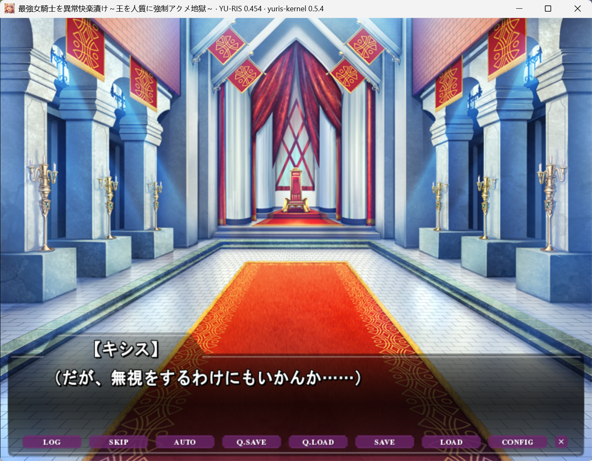</a> | <a href="docs/assets/case/6_d.png">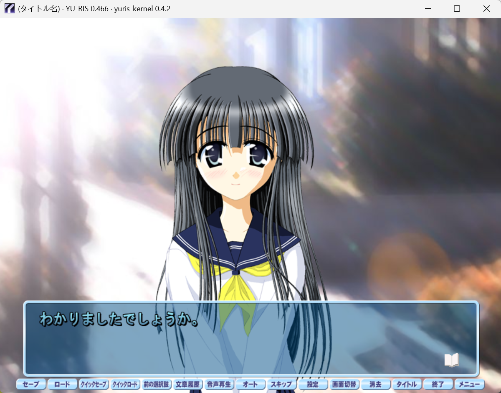</a> | <a href="docs/assets/case/5_t.png">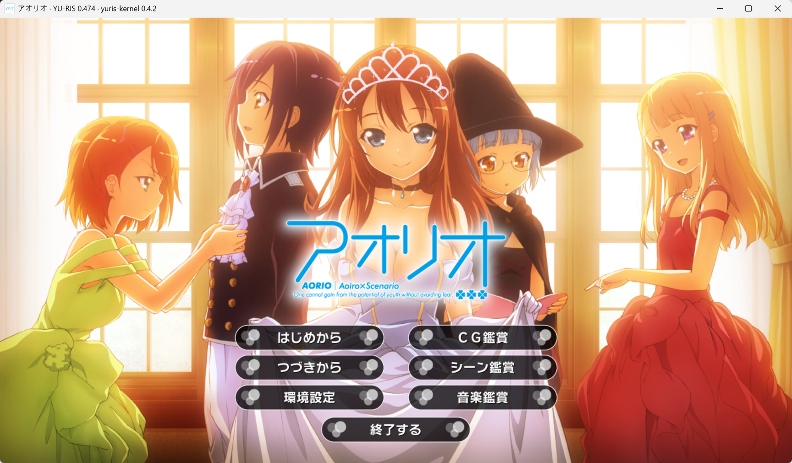</a> |
| **0.481 · Title screen** | **0.481 · Dialogue** | **0.494 · Dialogue** |
| <a href="docs/assets/case/1_t.png">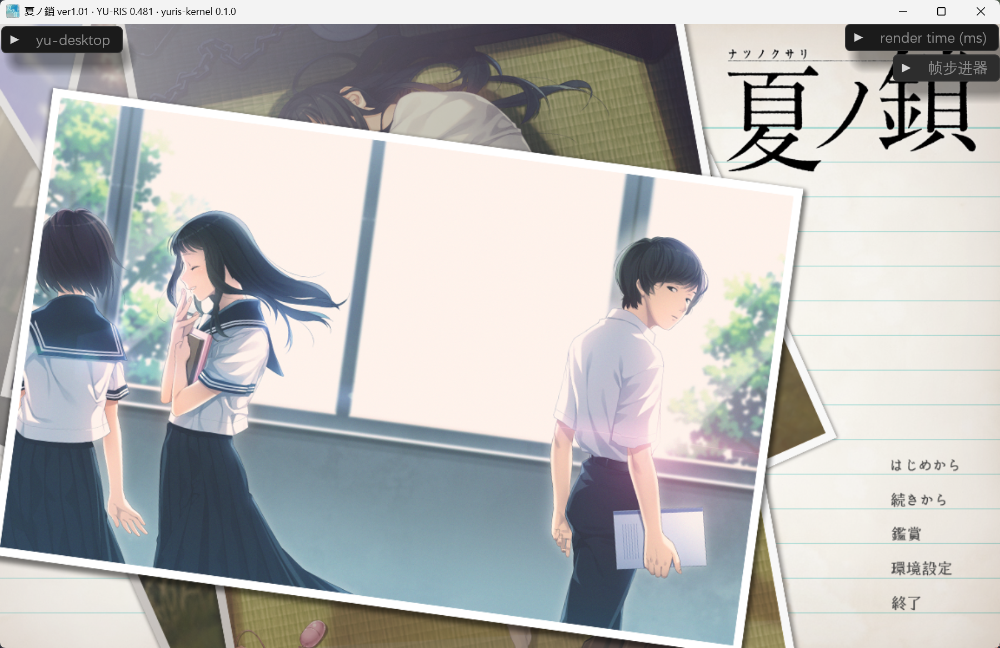</a> | <a href="docs/assets/case/1_d.png">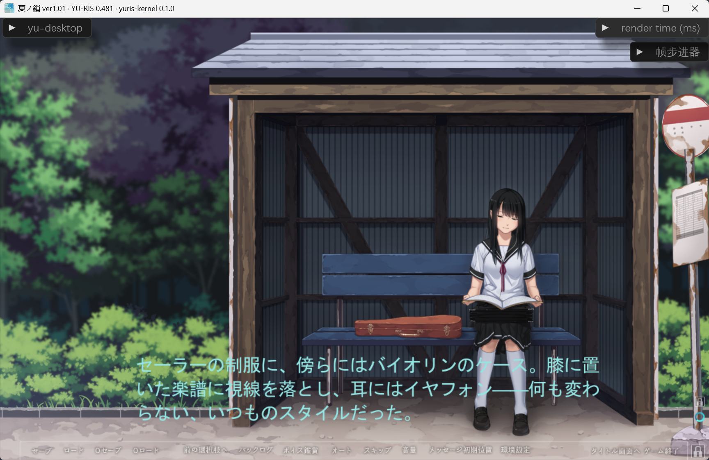</a> | <a href="docs/assets/case/2_d.png">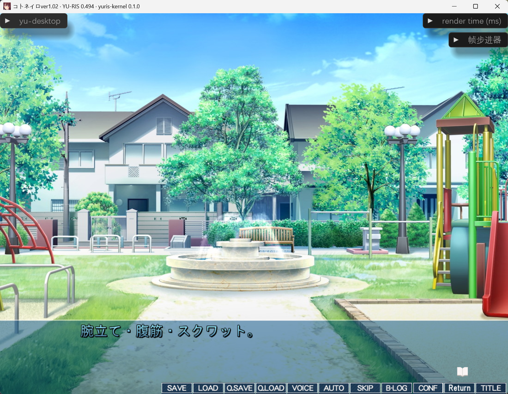</a> |
| **0.500 · Title screen** | **0.500 · Dialogue** | **0.555 · Dialogue** |
| <a href="docs/assets/case/7_t.png">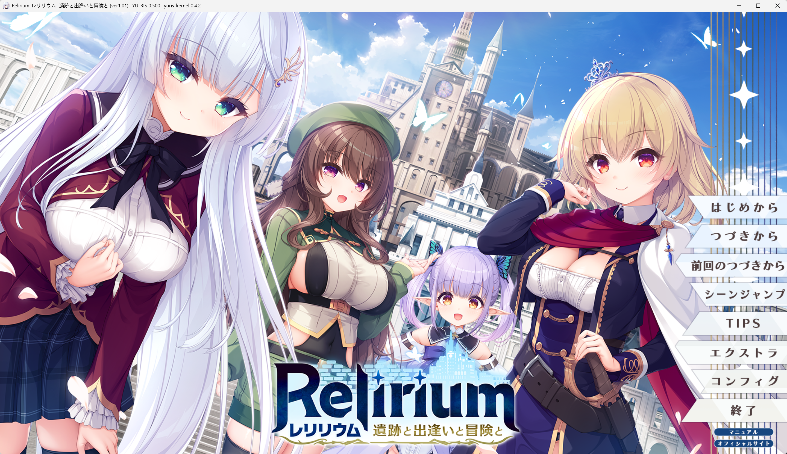</a> | <a href="docs/assets/case/8_d.png">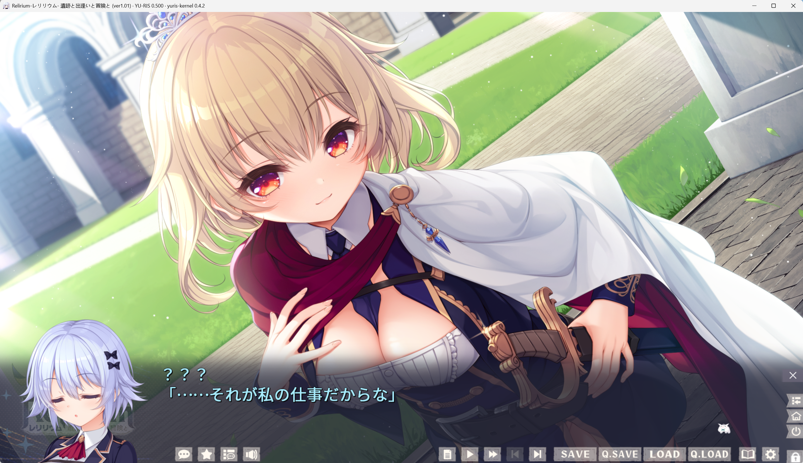</a> | <a href="docs/assets/case/3_d.png">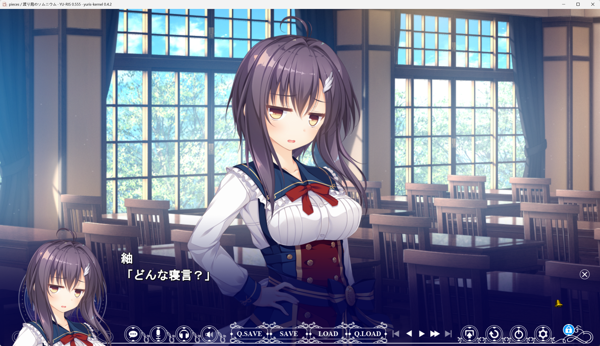</a> |
| **0.555 · Official Chinese** | | |
| <a href="docs/assets/case/4_d.png">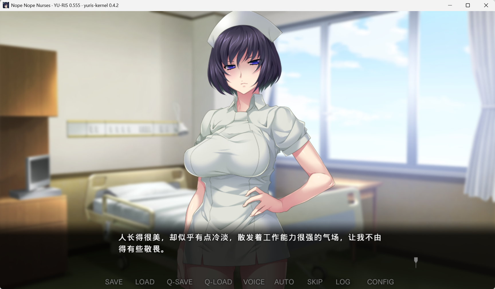</a> | | |

## Download

Prebuilt artifacts are on [Releases](https://github.com/NotFaceGUI/yuris-kernel/releases):

| Platform    | Artifact                                        | Contents                          |
| ----------- | ----------------------------------------------- | --------------------------------- |
| Windows x64 | `yuris-kernel-vX.Y.Z-windows-x64.zip`           | `yu-cli.exe` + `yu-serve.exe`     |
| Android     | `yuris-kernel-vX.Y.Z-android-universal.apk`     | Universal (arm64-v8a + x86_64)    |
| Android     | `...-android-arm64-v8a.apk` / `-x86_64.apk`     | Per-ABI packages                  |

The desktop build is unpack-and-run. On Android, install the APK and pick a game directory in the configuration screen. To build or debug the kernel yourself, continue to the next section.

## Quick start

### Requirements

- **Desktop**: Rust stable (2021 edition); Windows x64 verified, Linux / macOS unverified.
- **Android**: JDK 17+, Android SDK (`minSdk 24`, i.e. Android 7.0+);
  `tools/android/build.sh` automatically picks the highest version under `$ANDROID_HOME/ndk`.
- **Runtime data**: you must supply legally obtained game data; the repository ships none.

### Build

```bash
cargo build --release -p yu-cli
```

Windows x64 desktop is verified; Linux / macOS desktop is unverified. Android build commands are below and in the [Android](#android) section.

```bash
# Android: cross-compile .so + package APK
export ANDROID_HOME=/path/to/sdk ANDROID_NDK_HOME=/path/to/ndk JAVA_HOME=/path/to/jdk17
tools/android/build.sh                  # debug
BUILD_TYPE=release tools/android/build.sh
YURIS_SO_ONLY=1 tools/android/build.sh  # .so only
```

### Run

Data entry follows the official mount rules: if the project root has a `data/` directory, it is a development project layout (data root = `data/`); otherwise it is a release layout (data root = project root). All `*.ypf` files under the data root and its `pac/` are mounted by file name, later mounts overriding earlier ones; `update1..9.ypf` stack as incremental layers; loose-file content directories are layered on top of packs.

```bash
# Minimal run: game directory with data.ypf or data/
target/release/yu-cli run "<game-dir>" --mode desktop

# Windows desktop window
target/release/yu-cli run "<project>" --mode desktop --backend wgpu --debug-ui

# Local server + browser presentation; opens the browser by default, --no-open serves only
target/release/yu-cli serve "<project>" --backend wgpu --port 4173

# HMR
target/release/yu-cli dev "<project>" --backend wgpu --port 4173

# Cases
target/release/yu-cli case "<project>" --all

# Translation patches
target/release/yu-cli run "<project>" --mode desktop --patch gbk
target/release/yu-cli run "<project>" --mode desktop --patch big5
target/release/yu-cli run "<project>" --mode desktop --patch tunnel

# Rekeyed titles: specify the script key explicitly (8 hex digits; auto-detected by default); compress saves on write
target/release/yu-cli run "<project>" --mode desktop --backend wgpu \
  --script-key 0x1A2B3C4D --save-codec snappy
```

## Text encoding

`--patch` selects the translation route; desktop, serve, and the Android configuration screen share the same values.

| Patch type        | Value (aliases)             | Notes                                                                                              |
| ----------------- | --------------------------- | -------------------------------------------------------------------------------------------------- |
| Original Japanese | `original` (`off` / `none` / `cp932` / `sjis` / `shift_jis`) | Untranslated original                                                              |
| Simplified Chinese| `gbk` (`cp936` / `gb2312`)  | Translation patch; the translated text lives in loose `ysbin/`, taking effect via "loose before pack" |
| Traditional Chinese | `big5` (`cp950` / `big-5`) | Same as above, for Hong Kong / Taiwan releases and traditional patches                             |
| Korean            | `cp949` (`uhc` / `euc-kr` / `kr`) | Korean patches and localized builds; shares GBK's lead table, so `auto` never guesses — select explicitly |
| Western European  | `cp1252` (`windows-1252` / `es`) | Spanish and other Western European single-byte localizations; `auto` never guesses — select explicitly |
| UTF-8 localized   | `utf8` (`utf-8`)            | Localized releases (e.g. Kagura) whose whole text is UTF-8; Auto usually detects it                |
| SJIS tunnel       | `tunnel` (`sjis_ext`)       | Patch that keeps the original encoding and appends a codepoint table; requires `sjis_ext.bin` in the game root |
| Auto              | `auto` (default)            | Detected via `codecs.json` → `sjis_ext.bin` → tool signatures; patch names are not recognized      |
| Runtime translation | `--translate` + `translate.json` (CP932 tunnel auto-extended, UTF-8 written directly) | Replaces in-file entries only, never writes back data; target codec follows the active `--patch` |
| Patch font        | `hook.ini` + ttf (auto-detected) | CP932-carrier glyph remap; force-injected into every `FONT` request at boot                     |
| v555 native multilingual | `config.sd` language number → `scenario/` / `sc_cn_scenario/` / `sc_tw_scenario/` | CP932 / GBK / Big5; not the `--patch` translation route |
| Unsupported       | —                           | exe / DLL injection patches (e.g. `setdll` loading `MyDll.dll` to swap fonts): the program is not modified, so they do not apply |

> v555 native multilingual support is not the `--patch` translation route:
> `scenario/`, `sc_cn_scenario/` and `sc_tw_scenario/` variants are selected by
> the language number in `config.sd`, with CP932 / GBK / Big5 codecs respectively;
> `--patch gbk` is only for translation patches / legacy projects.

<table>
<tr>
<td align="center">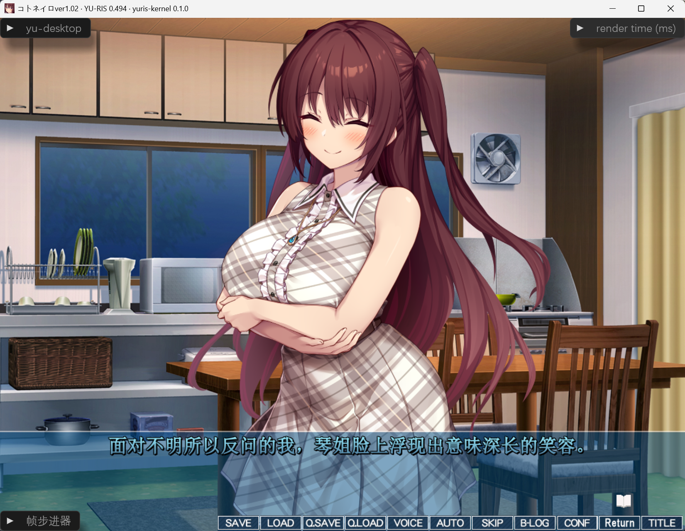<br><sub><b>GBK patch</b></sub></td>
<td align="center">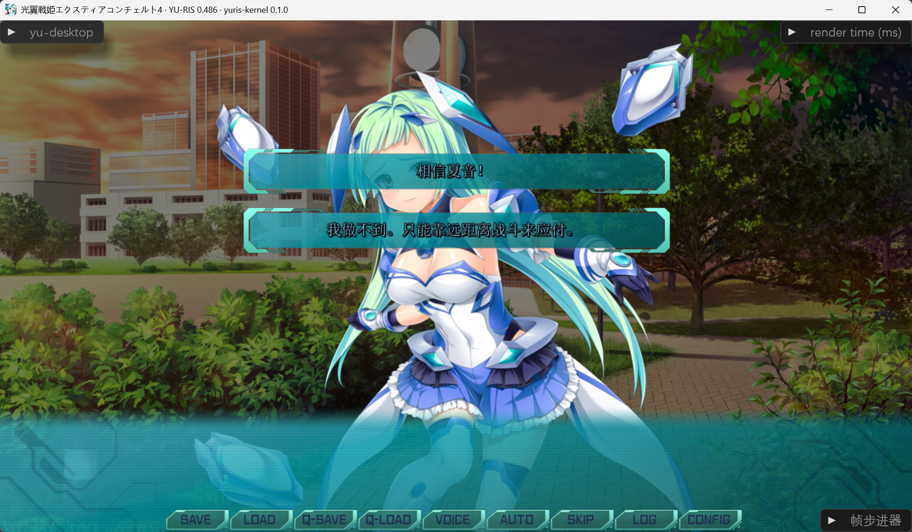<br><sub><b>SJIS tunnel</b></sub></td>
</tr>
</table>

## Android

.so + lightweight Java shell

- Build: `tools/android/build.sh`, producing `app-debug.apk` / `app-release.apk` (arm64-v8a + x86_64).
- After installation, pick a game directory to run; saves go to `<game-dir>/save/`, and `.sd` files are byte-identical with desktop.
- Input: touch = left mouse button, two-finger vertical swipe = wheel, bottom-right corner toggles the virtual cursor.
- Exit: after the script `END`, return to the configuration screen.

<p align="center">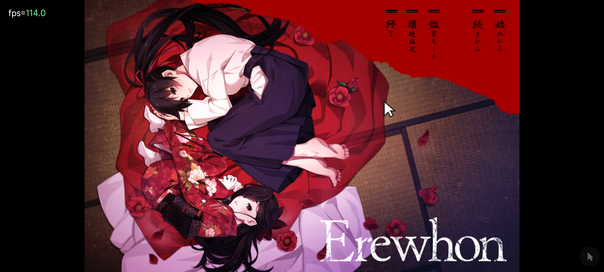</p>

## Architecture

`yu-engine` owns boot assembly and each frame's `Vm::tick_at` / render calls. The diagram shows data flow, not the crate dependency graph; `yu-trace` is a side attachment.

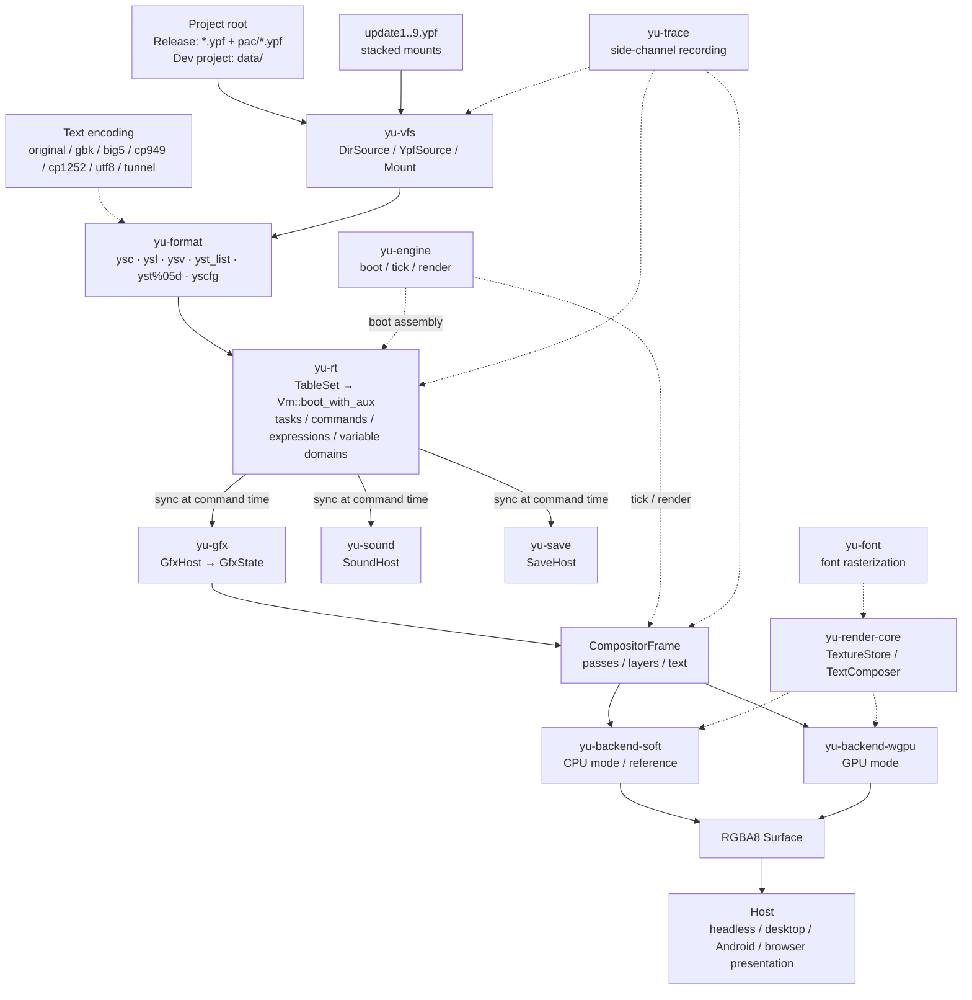

Boot sequence: `Project` discovers the data entry → `Vm::boot_with_aux` loads tables and entry → `GfxState::from_tables` → `GfxHost` / `SoundHost` / `SaveHost` are installed into the VM. Each frame, `Vm::tick_at` runs tasks and domain hosts update synchronously at command time; `GfxState::frame()` produces a `CompositorFrame`, and the backend composites RGBA8.

## Project structure

| Path                                              | Contents                                   |
| ------------------------------------------------- | ------------------------------------------ |
| `crates/yu-log`                                   | Diagnostics and logging; error exit for all crates |
| `crates/yu-vfs`                                   | Data sources, YPF, mounts                  |
| `crates/yu-format`                                | ybn, YSSD, YMV, CP932/GBK/Big5             |
| `crates/yu-rt`                                    | VM, tasks, command dispatch, variable domains, ABI tables |
| `crates/yu-gfx`                                   | Render semantics and `CompositorFrame`     |
| `crates/yu-sound` / `crates/yu-save`              | Sound / save hosts                         |
| `crates/yu-font`                                  | Font discovery and glyph rasterization     |
| `crates/yu-render/core`                           | Shared contract for both backends          |
| `crates/yu-render/soft` / `crates/yu-render/wgpu` | CPU reference / primary GPU backend        |
| `crates/yu-engine`                                | boot / tick / render assembly              |
| `crates/yu-cli`                                   | CLI, server, HMR, cases                    |
| `crates/yu-platform/*`                            | Desktop, Android, browser presentation, input |
| `crates/yu-trace`                                 | Record / replay / diff                     |
| `android/`                                        | Android shell (Java)                       |
| `tools/android/build.sh`                          | .so cross-compilation + APK packaging      |

## Testing

```bash
cargo test --workspace
```

The repository ships no game data. Tests that need missing samples explicitly `SKIP` and count it; `YURIS_REQUIRE_SAMPLES=1` turns that into a failure. CI runs only sample-independent lib tests (`.github/workflows/ci.yml`); a full `--workspace` run also covers corpus and GPU cases, which need local samples and a usable GPU.

## Todo

- Rendering: multi-part layer geometry semantics; `CGINFO[SX/SY]` already covers injected assets and `COPY/COPY2` slices, but non-injected assets are still missing; fields such as `COLOR` and non-EXIST fields for missing targets are not closed out; half-pixel / quad phase and transition coverage await final verdicts from official screenshots.
- Text: the official two-layer model (pending display buffer + committed surface), `C/R/P/E`, width wrapping / kinsoku, and per-character styling are landed per REA; `TEXTINFO[CX/CY]` too. Remaining: GDI glyph ink/baseline not yet settled against official screenshots (DIV-GFX-056), and command ordering between text and image processing (DIV-GFX-076).
- Fonts: the game's own "Settings → Font" screen is wired to the full catalogue (host default font first + local system fonts), and switching in-game takes effect immediately; `--font` now means the default font, `--font-lock` keeps the old forced behavior. Remaining: per-glyph missing-glyph fallback and the game's hardcoded default label (DIV-FONT-012); bitmap fonts (`.fnt/.fon`) have no reference sample and stay explicitly unsupported.
- Formats: YSTB V2 lacks samples; the legacy YPF NUL-XOR dialect has no samples and is explicitly rejected.
- Runtime: `CSVINFO` not yet evidenced; `VAR` and `SAVEINFO` aligned with the official no-op behavior.
- Saves: `FILEACT` layer export not closed out; `FILEACT[EXEC]` refuses to execute (host security policy).
- Hosts: `REGINFO` is wired on desktop (Windows registry); Linux / macOS desktop and true wasm (in-memory data source + browser saves) are unverified.
- Movies: MPEG-1 program streams play (video + MP2 audio); MPEG-2 / AVI / FLASH and others need new media / Flash hosts; `MOVIE[PLAY=0]` and A/V clock drift are not aligned.
- E-mote: submodule `yu-emote/`, mainline deferred.

## Documentation

- `PROGRESS.md` — progress, errata, verification results
- `docs/architecture.md` — architecture
- `docs/cross-platform.md` — cross-platform capability matrix
- `docs/architecture/backends.md` — soft / wgpu boundary
- `docs/render-parity.md` — render semantics and evidence
- `docs/todo-inventory.md` — historical gap snapshot (2026-10-22; current status is tracked in `PROGRESS.md` and the individual ledgers)
- `docs/references/open-source-tools.md` — tool references
- `docs/release.md` — tag releases and artifacts
- `android/README.md` — Android shell build and on-device verification
- Each crate's `README.md` — responsibility boundary, ports, and verification commands; `crates/yu-platform` and `crates/yu-render` are directory indexes

## Acknowledgements

- [YU-RIS_Guide](https://github.com/TheVNConnoisseur/YU-RIS_Guide) —
  archive of official tools and SDKs (no license declared); the 27 system-variable ABI tables were extracted from its `YSCom.ycd`, and the repository ships no SDK / ycd originals; each table header records the source sha256 and covered version range (`crates/yu-rt/data/sysvar-abi-*.tsv`).
- [Yuris-Tyn](https://github.com/Weiss-UltimateSavior/Yuris-Tyn) —
  boot chain, task / driver shape, format facts, and golden regression reference; read-only.
- [RxYuris](https://github.com/ZQF-ReVN/RxYuris) — YSTB / YSCM / YSTL parsing flow, YSCOM loader.
- [YU-RIS-Script-Editor](https://github.com/Aionfatedio/YU-RIS-Script-Editor) —
  YSTB V5 segment order, V2 version-band detection, encoding auto-detection; no license declared, used as facts only, no code copied.
- [yuris_decompiler](https://github.com/shimamura-sakura/yuris_decompiler) —
  V2 expression type-qualifier mapping (`$@` / `&$` / `&@`) and V2/V5 structural facts;
  MIT, algorithm-level adoption with attribution (no source copied verbatim).
- [YURIS_TOOLS](https://github.com/jyxjyx1234/YURIS_TOOLS) — translation text workflow and tunnel codepoint allocation algorithm.

## Related repositories

- [yu-emote](https://github.com/NotFaceGUI/yu-emote) — E-mote (PSB/EMT) data layer and
  runtime; mounted as a submodule at `yu-emote/`, development deferred.

## Disclaimer

- This project is an independently implemented YU-RIS compatible runtime and is not affiliated with, authorized by, or endorsed by the developer or publisher of the YU-RIS engine; product names and trademarks belong to their respective owners.
- The repository contains no official engine code, game data, saves, or game assets. Screenshots in the documentation are only for demonstrating compatibility; rights belong to the respective game rights holders. Users must obtain the game and related assets legally on their own.
- This project is for personal study, research, and compatibility testing. Please comply with local laws and game license agreements, and do not use it for piracy, unauthorized data distribution, or other infringing purposes.
- The software is provided "as is", without any warranty of compatibility, stability, or save/data integrity; use is at your own risk.

## License

<a href="LICENSE"></a>

Open-source projects referenced by this project are listed in [Acknowledgements](#acknowledgements); third-party crate dependencies are all MIT / Apache-2.0 / BSD / Zlib or other permissive licenses compatible with GPL-3.0.

Unless otherwise stated, all source code is released under **[GPL-3.0-or-later](LICENSE)**. See
[NOTICE](NOTICE) for the full licensing statement; third-party components, dependency lists, and license texts are in
[THIRD-PARTY-NOTICES.md](THIRD-PARTY-NOTICES.md) and
[`third_party/licenses/`](third_party/licenses/).

To distribute a modified version while keeping added code non-GPL-3.0, contact the author via [@NotFaceGUI](https://github.com/NotFaceGUI) for a separate license.
