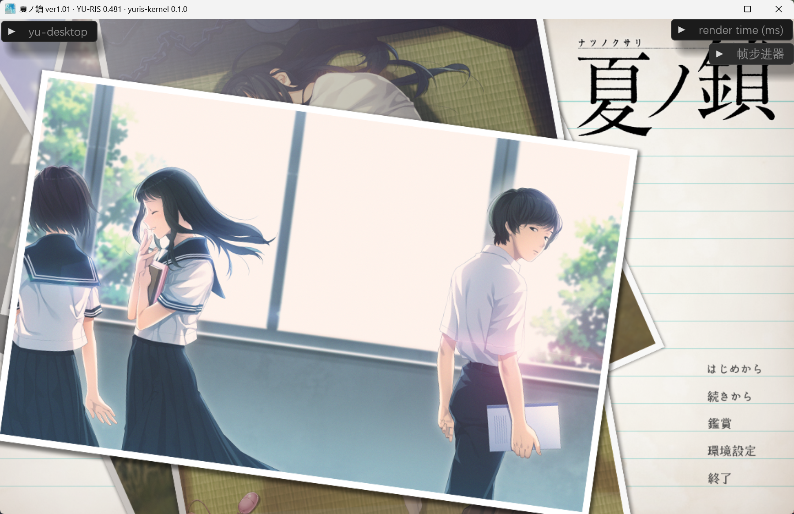
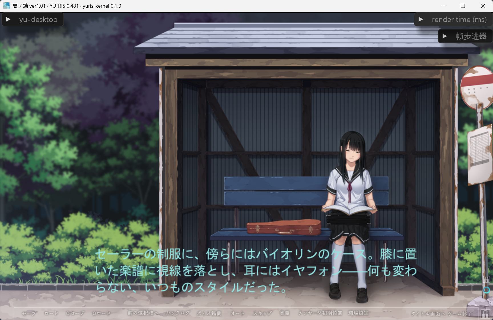
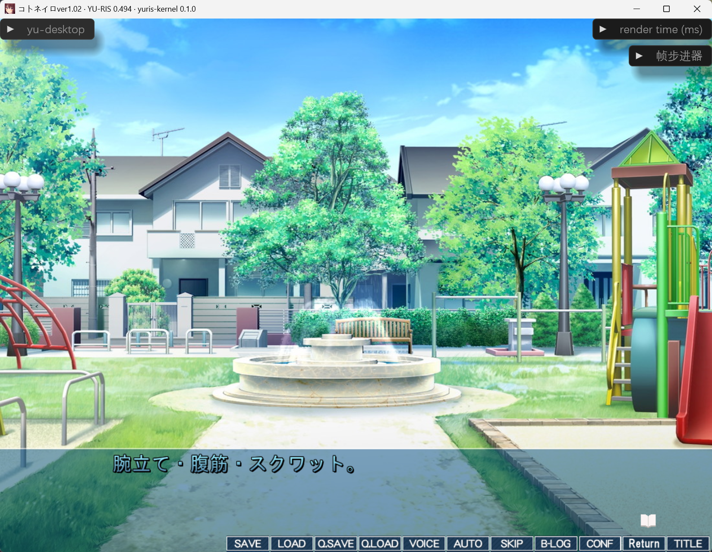
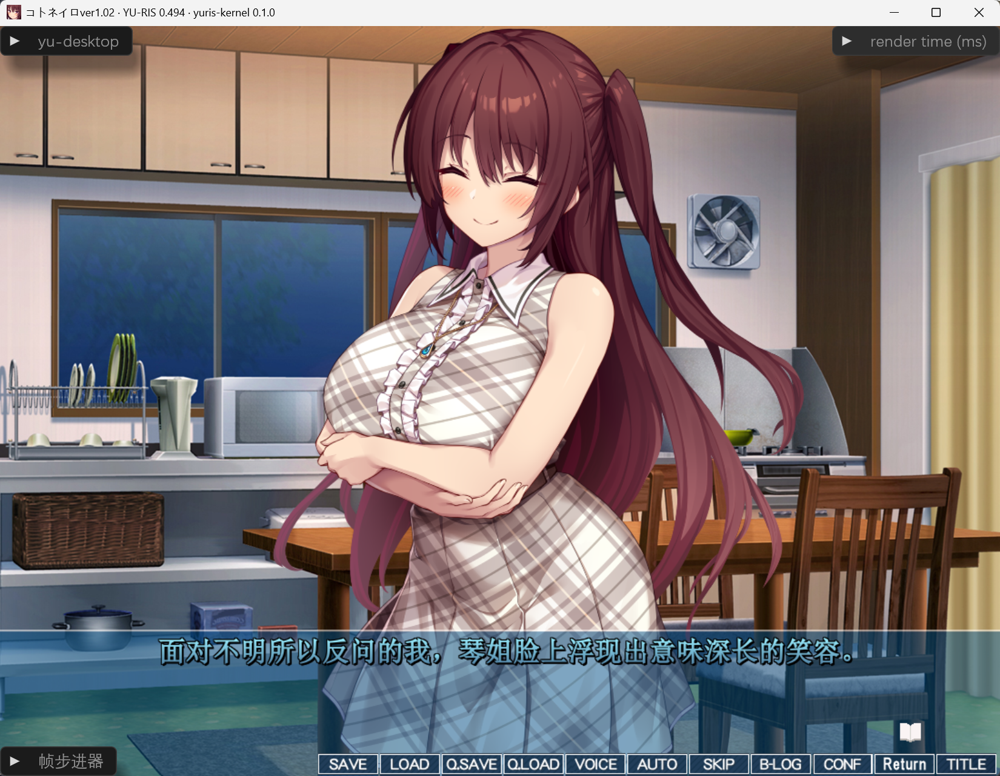
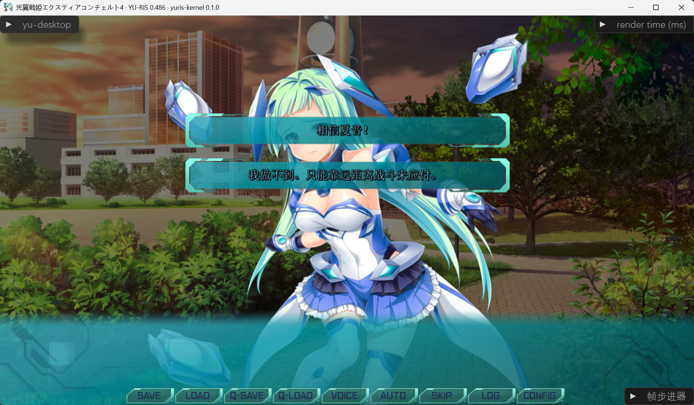
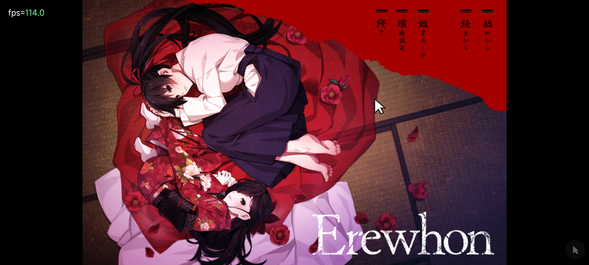
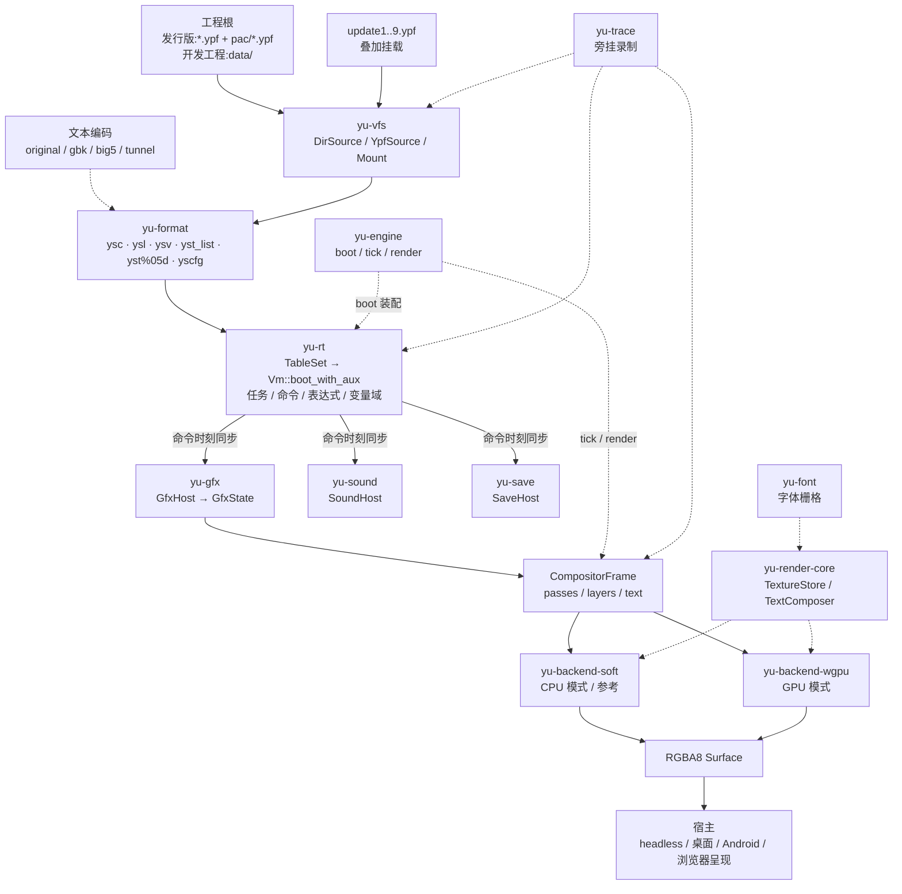

<div align="center">

<h1>yuris-kernel</h1>

<p><b>YU-RIS 兼容运行时</b><br>
以官方引擎的可观测行为为唯一真值</p>

<p>
<a href="https://github.com/NotFaceGUI/yuris-kernel/actions/workflows/ci.yml"></a>
<a href="LICENSE"></a>
<a href="https://github.com/NotFaceGUI/yuris-kernel/releases"></a>


</p>

<p><b>简体中文</b> · <a href="README.en.md">English</a></p>

<p>
<a href="#简介">简介</a> ·
<a href="#支持范围">支持范围</a> ·
<a href="#演示">演示</a> ·
<a href="#下载">下载</a> ·
<a href="#快速开始">快速开始</a> ·
<a href="#android">Android</a> ·
<a href="#架构">架构</a> ·
<a href="#文档">文档</a> ·
<a href="#许可">许可</a>
</p>

</div>

## 简介

`yuris-kernel` 是 YU-RIS 引擎的兼容运行时，仓库不包含官方引擎代码、游戏数据或存档。

- **多版本覆盖** —— 官方系列 BETA 2 / BETA 3 / BETA 4：
  BETA 4 主线（0.450–0.495），BETA 3（0.276–0.292）/ BETA 2（0.255）适配中；
  官方商业 5xx 分支（v500 封包 / v555 七表）适配中；27 张 0.255–0.495
  系统变量 ABI 表已入册，另有 v555 1000 槽实测表（在 `v555-support` 分支）。
- **双渲染后端** —— `soft`（CPU，确定性参考）与 `wgpu`（GPU，桌面 / Android 主路径）。
- **多宿主** —— Windows 桌面、headless / 本地服务、浏览器呈现（调试）、Android。
- **汉化与存档** —— `original` / `gbk` / `big5` / `tunnel` 四条文本路线；
  `.sd` 存档与桌面字节一致。
- **可观测** —— `yu-trace` 录制 / 回放 / diff，用于和官方引擎逐帧对拍。

## 支持范围

### 引擎版本

官方版本分为 BETA 2 / BETA 3 / BETA 4 三个主线系列；5xx 是 YU-RIS 官方商业分支（商业发行版），不属于这三条主线。个别商业样本的发行包可能带重打包/汉化处理，但那是样本层面的处理，不是引擎本身。

| 系列 | 状态         | 说明                                                                                                                                                            |
| ---- | ------------ | --------------------------------------------------------------------------------------------------------------------------------------------------------------- |
| BETA 2 | 适配中     | 0.255（0.55）：539 系统变量表已入册；YSTB V2 缺真实样本                                                                                                          |
| BETA 3 | 适配中     | 0.276 样本；0.292（0.92）：91 命令 / 482 系统变量                                                                                                                |
| BETA 4 | 可用（主线） | 0.450–0.495：0.466 / 0.479 / 0.495：100 / 104 / 119 命令，513 / 526 / 548 系统变量；0.450 / 0.460 / 0.470 / 0.480 / 0.490 抽样实机通过，0.481 / 0.486 / 0.494 / 0.495 实机验收 |
| 5xx    | 适配中（v555） | 官方商业分支：v500 封包可读；v555 七表/剧本链已实测；已落地 `TEXT[FILE]`、`PRODUCT`、`SAVE/LOAD[MEM]`、`_DROPFILE*`、`VARINFO`；剩余 P0 标题画面（`_STR`/按钮纹理/SPL/背景 CG） |

0.450–0.493 各版本的 ABI 表已全部入册（27 张，覆盖 0.255–0.495）。

### 5xx / v555 现状

- **官方商业分支**：v500 封包、v555 七表（YSCM/YSLB/YSVR/YSTL/YSER/YSCF/YSTD）均已实测；
  剧本密钥 = CRC32(作品 ID)，启动链、剧本 DSL 词法/宏、标签表、品牌影片、
  GAMEMain UI 图层已打通，headless 已到标题选择循环。
- **原生多语言**：v555 剧情文本外置为 `scenario/`（基准）、`sc_cn_scenario/`（简中）、
  `sc_tw_scenario/`（繁中）三份变体，由 `config.sd` 里的语言号选择；
  实测编码分别为 CP932 / GBK / Big5。当前内核对多语言仍依赖全局 `--patch gbk`，
  正在按语言变体收口（优化计划 O5）。
- **仍缺**：P0-1 `_STR`、P0-2 按钮纹理状态机、P0-3 SPL 过渡、P0-4 背景 CG；
  `MEM=99999`、`PRODUCT` 其它 COM、正文逐字对拍。
- **文档**：v555 普查/差距/ABI 与多语言调研在 `v555-support` 分支的
  `docs/formats/v555-commercial.md`、`v555-gap-2026-11-19.md`，待合并。

### 宿主平台

| 平台                | 状态   |
| ------------------- | ------ |
| Windows 桌面        | 可用   |
| headless / 本地服务 | 可用   |
| 浏览器呈现端        | 仅调试 |
| Android             | 可用   |
| Linux / macOS 桌面  | 未验证 |

Linux / macOS 桌面与真 wasm（内存数据源 + 浏览器存档）的缺口见[待办](#待办)。

## 演示

| 0.481 · 标题画面 | 0.481 · 对话 | 0.494 · 对话 |
| :---: | :---: | :---: |
| [](docs/assets/case/1_t.png) | [](docs/assets/case/1_d.png) | [](docs/assets/case/2_d.png) |

## 下载

预构建产物见 [Releases](https://github.com/NotFaceGUI/yuris-kernel/releases)：

| 平台         | 产物                                             | 内容                              |
| ------------ | ------------------------------------------------ | --------------------------------- |
| Windows x64  | `yuris-kernel-vX.Y.Z-windows-x64.zip`            | `yu-cli.exe` + `yu-serve.exe`     |
| Android      | `yuris-kernel-vX.Y.Z-android-universal.apk`      | 通用包（arm64-v8a + x86_64）      |
| Android      | `...-android-arm64-v8a.apk` / `-x86_64.apk`      | 按 ABI 分包                       |

桌面版解压即用；Android 安装 APK 后，在配置界面选择游戏目录即可。
需要自己构建或调试内核时，继续看下一节。

## 快速开始

### 环境要求

- **桌面**：Rust stable（2021 edition）；Windows x64 已验证，Linux / macOS 未验证。
- **Android**：JDK 17+、Android SDK（`minSdk 24`，即 Android 7.0+）；
  NDK 由 `tools/android/build.sh` 自动取 `$ANDROID_HOME/ndk` 下最高版本。
- **运行数据**：自备合法获取的游戏数据；仓库不附带。

### 构建

```bash
cargo build --release -p yu-cli
```

Windows x64 桌面已验证；Linux / macOS 桌面未验证。Android 构建见下方命令
与 [Android](#android) 小节。

```bash
# Android：so 交叉编译 + APK 打包
export ANDROID_HOME=/path/to/sdk ANDROID_NDK_HOME=/path/to/ndk JAVA_HOME=/path/to/jdk17
tools/android/build.sh                  # debug
BUILD_TYPE=release tools/android/build.sh
YURIS_SO_ONLY=1 tools/android/build.sh  # 只出 so
```

### 运行

数据入口按官方挂载规则：工程根下有 `data/` 目录即开发工程布局
（数据根 = `data/`），否则为发行版布局（数据根 = 工程根）。
数据根及其 `pac/` 下的全部 `*.ypf` 按文件名挂载，后挂覆写先挂；
`update1..9.ypf` 依次叠加为增量层；散盘内容目录叠在包之上。

```bash
# 最小运行：游戏目录含 data.ypf 或 data/
target/release/yu-cli run "<游戏目录>" --mode desktop

# Windows 桌面窗口
target/release/yu-cli run "<project>" --mode desktop --backend wgpu --debug-ui

# 本地服务 + 浏览器呈现；默认打开浏览器，--no-open 只起服务
target/release/yu-cli serve "<project>" --backend wgpu --port 4173

# HMR
target/release/yu-cli dev "<project>" --backend wgpu --port 4173

# 用例
target/release/yu-cli case "<project>" --all

# 汉化
target/release/yu-cli run "<project>" --mode desktop --patch gbk
target/release/yu-cli run "<project>" --mode desktop --patch big5
target/release/yu-cli run "<project>" --mode desktop --patch tunnel

# 换钥作品:显式指定脚本密钥(8 位十六进制;缺省自动探测);存档写盘压缩
target/release/yu-cli run "<project>" --mode desktop --backend wgpu \
  --script-key 0x1A2B3C4D --save-codec snappy
```

## 文本编码

`--patch` 选汉化路线；桌面、serve、Android 配置界面用同一份取值。

| 汉化类型  | 取值                        | 说明                                                                          |
| --------- | --------------------------- | ----------------------------------------------------------------------------- |
| 原版日文  | `original`（`cp932`）       | 未汉化的原版                                                                  |
| 简体汉化  | `gbk`（`cp936` / `gb2312`） | 汉化补丁；译文放在散盘 `ysbin/`，靠「散盘先于封包」的读链生效                 |
| 繁体汉化  | `big5`（`cp950`）           | 同上，港台旧作与繁中补丁                                                      |
| SJIS 隧道 | `tunnel`（`sjis_ext`）      | 不动原编码、追加码点表的补丁；需游戏根有 `sjis_ext.bin`                       |
| 自动      | `auto`（缺省）              | 按 `codecs.json` → `sjis_ext.bin` → 工具签名识别；不认补丁名                  |
| 不支持    | —                           | exe / DLL 注入类补丁（如 `setdll` 挂 `MyDll.dll` 换字体）：不改程序，故不适用 |

> v555 原生多语言不是 `--patch` 汉化路线：`scenario/`、`sc_cn_scenario/`、
> `sc_tw_scenario/` 三份变体由 `config.sd` 的语言号选择，codec 分别为
> CP932 / GBK / Big5；`--patch gbk` 只用于汉化补丁/旧工程。

<table>
<tr>
<td align="center"><br><sub><b>GBK 汉化</b></sub></td>
<td align="center"><br><sub><b>SJIS 隧道</b></sub></td>
</tr>
</table>

## Android

so + 轻量 Java 壳

- 构建：`tools/android/build.sh`，产物 `app-debug.apk` / `app-release.apk`（arm64-v8a + x86_64）。
- 安装后选游戏目录即可运行；存档写 `<游戏目录>/save/`，`.sd` 与桌面字节一致。
- 输入：触摸 = 鼠标左键，双指上下滑 = 滚轮，右下角切换虚拟光标。
- 退出：脚本 `END` 后回到配置界面。

<p align="center"></p>

## 架构

`yu-engine` 负责 boot 装配与每帧 `Vm::tick_at` / render 调用。下图是数据流，
不是 crate 依赖图；`yu-trace` 是旁挂。



启动顺序：`Project` 发现数据入口 → `Vm::boot_with_aux` 装载表与入口 →
`GfxState::from_tables` → 把 `GfxHost` / `SoundHost` / `SaveHost` 装进 VM。
每帧 `Vm::tick_at` 执行任务，域宿主在命令时刻同步更新；`GfxState::frame()`
产出 `CompositorFrame`，后端合成 RGBA8。

## 项目结构

| 路径                                              | 内容                               |
| ------------------------------------------------- | ---------------------------------- |
| `crates/yu-log`                                   | 诊断与日志；所有 crate 的错误出口  |
| `crates/yu-vfs`                                   | 数据源、YPF、挂载                  |
| `crates/yu-format`                                | ybn、YSSD、YMV、CP932/GBK/Big5     |
| `crates/yu-rt`                                    | VM、任务、命令分派、变量域、ABI 表 |
| `crates/yu-gfx`                                   | 渲染语义与 `CompositorFrame`       |
| `crates/yu-sound` / `crates/yu-save`              | 声音 / 存档宿主                    |
| `crates/yu-font`                                  | 字体发现与字形栅格                 |
| `crates/yu-render/core`                           | 两后端共享契约                     |
| `crates/yu-render/soft` / `crates/yu-render/wgpu` | CPU 参考 / GPU 主后端              |
| `crates/yu-engine`                                | boot / tick / render 装配          |
| `crates/yu-cli`                                   | CLI、服务、HMR、用例               |
| `crates/yu-platform/*`                            | 桌面、Android、浏览器呈现、输入    |
| `crates/yu-trace`                                 | 录制 / 回放 / diff                 |
| `android/`                                        | Android 壳（Java）                 |
| `tools/android/build.sh`                          | so 交叉编译 + APK 打包             |

## 测试

```bash
cargo test --workspace
```

仓库不附带游戏数据。缺样本时相关用例显式 `SKIP` 并计数；
`YURIS_REQUIRE_SAMPLES=1` 改为失败。CI 只跑不依赖样本的 lib 测试
（`.github/workflows/ci.yml`）；完整 `--workspace` 还会覆盖语料与 GPU 用例，
需要本地样本与可用显卡。

## 待办

- 渲染：多部件层几何语义；`CGINFO[SX/SY]` 已覆盖已注入资产与 `COPY/COPY2`
  切片，未注入资产仍缺；`COLOR` 等字段、缺失目标的非 EXIST 字段未收口；
  半像素 / quad 相位与过渡覆盖度待官方截图定论。
- 文本：官方两层模型（待显示缓冲 + 已提交表面）、`C/R/P/E`、宽度折行/禁则、
  逐字符样式、`TEXTINFO[CX/CY]` 已按 REA 落地；残余：GDI 字迹/基线未与官方
  截图定论（DIV-GFX-056）、文字与图像加工的命令序（DIV-GFX-076）。
- 字体：游戏自带「設定→フォント」已接全量目录（宿主默认字体第一 + 本机
  系统字体），游戏内切换即时生效；`--font` 改为默认字体语义，`--font-lock`
  保留旧强制行为。残余：逐字形缺字回退、游戏硬编码默认标签（DIV-FONT-012）。
- 格式：YSTB V2 缺样本；YPF 旧 NUL-XOR 方言无样本，显式拒绝。
- 运行时：`CSVINFO` 未取证；`VAR`、`SAVEINFO` 已按官方 no-op 对齐。
- 存档：`FILEACT` 图层导出未闭环；`FILEACT[EXEC]` 拒绝执行（宿主安全策略）。
- 宿主：`REGINFO` 桌面已接（Windows 注册表）；Linux / macOS 桌面与真 wasm
  （内存数据源 + 浏览器存档）未验证。
- 影片：MPEG-1 program stream 可播（视频 + MP2 音频）；MPEG-2 / AVI / FLASH
  等需新的媒体 / Flash 宿主；`MOVIE[PLAY=0]` 与音视频时钟漂移未对齐。
- E-mote：子模块 `yu-emote/`，主线暂缓。

## 文档

- `PROGRESS.md` — 进度、勘误、验证结果
- `docs/architecture.md` — 架构
- `docs/cross-platform.md` — 跨平台能力矩阵
- `docs/architecture/backends.md` — soft / wgpu 边界
- `docs/render-parity.md` — 渲染语义与证据
- `docs/todo-inventory.md` — 历史缺口快照（2026-10-22；当前状态以
  `PROGRESS.md` 与各台账为准）
- `docs/references/open-source-tools.md` — 工具参考
- `docs/release.md` — tag 发布与产物
- `android/README.md` — Android 壳构建与实机验证
- 各 crate 的 `README.md` — 职责边界、端口与验证命令；`crates/yu-platform`、
  `crates/yu-render` 是目录索引

## 致谢

- [YU-RIS_Guide](https://github.com/TheVNConnoisseur/YU-RIS_Guide) —
  官方工具与 SDK 归档（仓库未声明许可）；27 张系统变量 ABI 表由其中
  `YSCom.ycd` 提取，仓库不附带 SDK / ycd 原文件；每张表头记录来源 sha256 与
  覆盖版本区间（`crates/yu-rt/data/sysvar-abi-*.tsv`）。
- [Yuris-Tyn](https://github.com/Weiss-UltimateSavior/Yuris-Tyn) —
  启动链、任务 / 驱动形态、格式事实与 golden 回归参照；只读参考。
- [RxYuris](https://github.com/ZQF-ReVN/RxYuris) — YSTB / YSCM / YSTL 解析流程、
  YSCOM Loader。
- [YU-RIS-Script-Editor](https://github.com/Aionfatedio/YU-RIS-Script-Editor) —
  YSTB V5 段序、V2 版本带判定、编码自检测；未声明许可，仅事实参考，未复制代码。
- [yuris_decompiler](https://github.com/shimamura-sakura/yuris_decompiler) —
  V2 表达式类型限定符映射（`$@` / `&$` / `&@`）与 V2/V5 结构事实；MIT，
  算法级采用并注明出处（未逐字复制源码）。
- [YURIS_TOOLS](https://github.com/jyxjyx1234/YURIS_TOOLS) — 汉化文本流程与
  隧道码点分配算法。

## 相关仓库

- [yu-emote](https://github.com/NotFaceGUI/yu-emote) — E-mote（PSB/EMT）数据层与
  运行时；以子模块挂在 `yu-emote/`，暂缓开发。

## 免责声明

- 本项目是独立实现的 YU-RIS 兼容运行时，与 YU-RIS 引擎的开发商、发行商无隶属、
  授权或背书关系；相关产品名与商标归其权利人所有。
- 仓库不包含官方引擎代码、游戏数据、存档或游戏素材文件；文档中的运行截图仅用于
  展示兼容性，相关权利归原游戏权利人。使用者需自行合法取得游戏本体及相关素材。
- 本项目面向个人学习、研究与兼容性测试。请遵守所在地法律与游戏许可协议，
  不要用于盗版、未经授权的数据分发或其他侵权用途。
- 软件按“现状”提供，不对兼容性、稳定性或存档/数据完整性作任何担保；
  使用风险由使用者自行承担。

## 许可

<a href="LICENSE"></a>

本项目参考的开源项目见 [致谢](#致谢)；第三方 crate 依赖均为 MIT / Apache-2.0 / BSD / Zlib 等与 GPL-3.0 兼容的宽松许可。

除另有说明外，全部源代码以 **[GPL-3.0-or-later](LICENSE)** 发布。完整许可声明见
[NOTICE](NOTICE)；第三方组件、依赖清单与许可文本见
[THIRD-PARTY-NOTICES.md](THIRD-PARTY-NOTICES.md) 与
[`third_party/licenses/`](third_party/licenses/)。

如需分发修改版并保留新增代码不按 GPL-3.0 发布，请通过 [@NotFaceGUI](https://github.com/NotFaceGUI) 联系作者获取单独许可。
