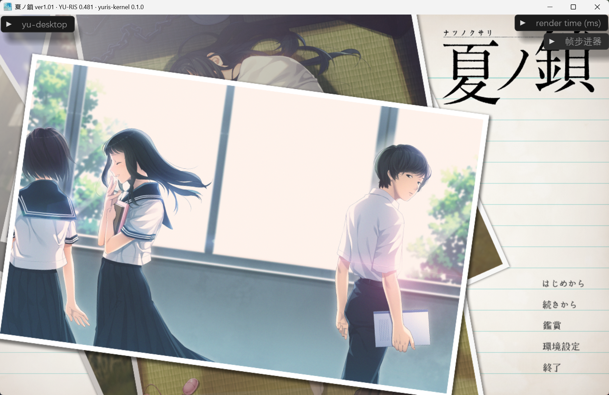
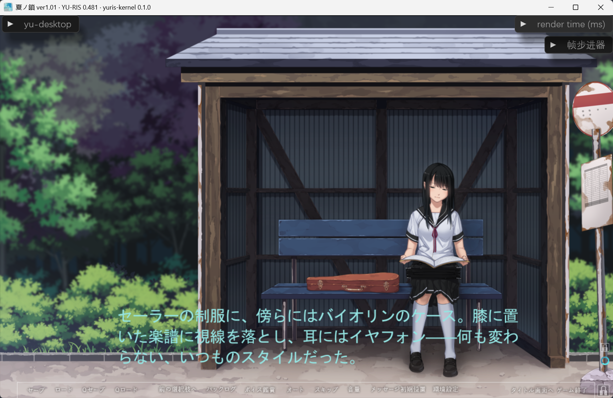
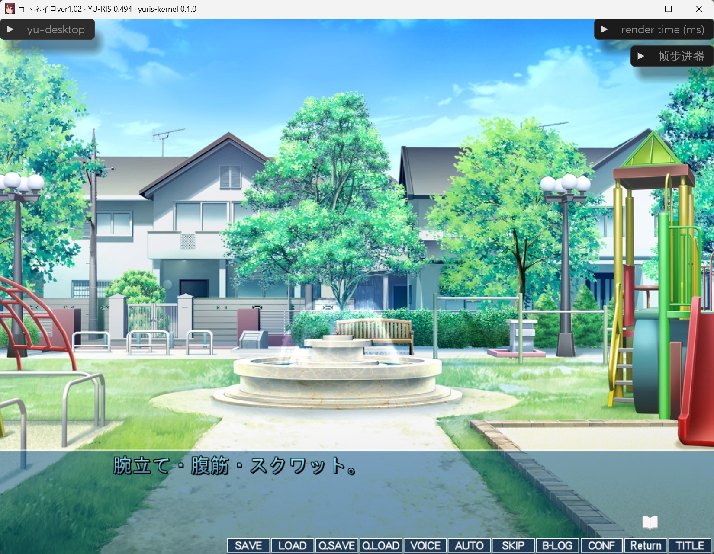
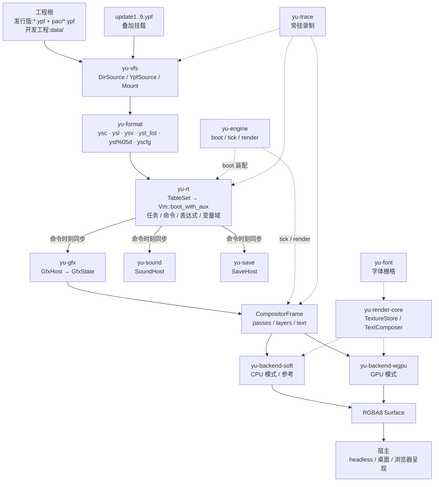

# yuris-kernel

YU-RIS 兼容运行时，开发中。

## 状态

当前主线是 4xx；2xx 适配中；5xx 未计划。

| 版本线 | 状态           | 说明                                                                                            |
| ------ | -------------- | ----------------------------------------------------------------------------------------------- |
| 2xx    | 适配中         | 0.292 SDK：91 命令 / 482 系统变量；YSTB V2 缺真实样本                                           |
| 4xx    | 适配中（主线） | 0.466 / 0.479 / 0.495：100 / 104 / 119 命令、513 / 526 / 548 系统变量；0.494 商业包 ABI 548/548 |
| 5xx    | 未计划         | 仅有旁线 v555 局部观察，无官方样本                                                              |

启动时按游戏自带的 `ysc` / `ysv` 校验选表；缺表或指纹不匹配拒绝启动，不按版本号分支。

| 平台                | 状态           |
| ------------------- | -------------- |
| Windows 桌面        | 可用           |
| headless / 本地服务 | 可用           |
| 浏览器呈现端        | 可用（调试期） |
| Android             | 未开始         |

|  |  |  |
| ----------------------------- | ----------------------------- | ----------------------------- |
| 0.481                         | 0.481                         | 0.494                         |

## 构建

```bash
cargo build --release -p yu-cli
```

Windows 下生成 `yu-cli.exe`；桌面宿主已实现，其他平台的完整构建未验证。

## 运行

数据入口按官方挂载规则：工程根下有 `data/` 目录即开发工程布局
（数据根 = `data/`），否则为发行版布局（数据根 = 工程根）。
数据根及其 `pac/` 下的全部 `*.ypf` 按文件名挂载，后挂覆写先挂；
`update1..9.ypf` 依次叠加为增量层；散盘内容目录叠在包之上。

```bash
# Windows 桌面窗口
target/release/yu-cli run "<project>" --mode desktop --backend wgpu --debug-ui

# 本地服务 + 浏览器呈现；默认打开浏览器，--no-open 只起服务
target/release/yu-cli serve "<project>" --backend wgpu --port 4173

# HMR
target/release/yu-cli dev "<project>" --backend wgpu --port 4173

# 用例
target/release/yu-cli case "<project>" --all

# 换钥作品:显式指定脚本密钥(8 位十六进制;缺省自动探测);存档写盘压缩
target/release/yu-cli run "<project>" --mode desktop --backend wgpu \
  --script-key 0x1A2B3C4D --save-codec snappy
```

## 测试

```bash
cargo test --workspace
```

仓库不附带游戏数据。缺样本时相关用例显式 `SKIP` 并计数；
`YURIS_REQUIRE_SAMPLES=1` 改为失败。

## 架构

`yu-engine` 负责 boot 装配与每帧 `Vm::tick_at` / render 调用。下图是数据流，
不是 crate 依赖图；`yu-trace` 是旁挂。



启动顺序：`Project` 发现数据入口 → `Vm::boot_with_aux` 装载表与入口 →
`GfxState::from_tables` → 把 `GfxHost` / `SoundHost` / `SaveHost` 装进 VM。
每帧 `Vm::tick_at` 执行任务，域宿主在命令时刻同步更新；`GfxState::frame()`
产出 `CompositorFrame`，后端合成 RGBA8。

## 目录

| 路径                                              | 内容                              |
| ------------------------------------------------- | --------------------------------- |
| `crates/yu-log`                                   | 诊断与日志；所有 crate 的错误出口 |
| `crates/yu-vfs`                                   | 数据源、YPF、挂载                 |
| `crates/yu-format`                                | ybn、YSSD、CP932/GBK              |
| `crates/yu-rt`                                    | VM、任务、命令分派、变量域        |
| `crates/yu-gfx`                                   | 渲染语义与 `CompositorFrame`      |
| `crates/yu-sound` / `crates/yu-save`              | 声音 / 存档宿主                   |
| `crates/yu-font`                                  | 字体发现与字形栅格                |
| `crates/yu-render/core`                           | 两后端共享契约                    |
| `crates/yu-render/soft` / `crates/yu-render/wgpu` | CPU 参考 / GPU 主后端             |
| `crates/yu-engine`                                | boot / tick / render 装配         |
| `crates/yu-cli`                                   | CLI、服务、HMR、用例              |
| `crates/yu-platform/*`                            | 桌面、浏览器呈现、输入            |
| `crates/yu-trace`                                 | 录制 / 回放 / diff                |

## 已知限制

- 渲染：MODE 4/8/10..18 未实现；组 RT / 子组 alpha、MID / 多部件、部分图像加工挂账。
- 格式：YSTB V2 缺样本；YPF 旧 NUL-XOR 方言无样本，显式拒绝。
- 文本：GRADATION / ROTATION / BNO 等为 Unverified；字形栅格不与 GDI 做字节级承诺。
- 存档：SAVEINFO、图层导出未闭环；FILEACT[EXEC] 拒绝执行。
- 宿主：Android 未开始；浏览器当前只做呈现。
- 版本：5xx 未计划。

## 文档

- `PROGRESS.md` — 进度、勘误、验证结果
- `docs/architecture.md` — 架构
- `docs/architecture/backends.md` — soft / wgpu 边界
- `docs/render-parity.md` — 渲染语义与证据
- `docs/todo-inventory.md` — 缺口清单
- `docs/references/open-source-tools.md` — 工具参考
- `docs/release.md` — tag 发布与本地预演

## 致谢

- [Yuris-Tyn](https://github.com/Weiss-UltimateSavior/Yuris-Tyn) —
  启动链、任务 / 驱动形态、格式事实与 golden 回归参照；只读参考。
- [RxYuris](https://github.com/ZQF-ReVN/RxYuris) — YSTB / YSCM / YSTL 解析流程、
  YSCOM Loader。
- [YU-RIS-Script-Editor](https://github.com/Aionfatedio/YU-RIS-Script-Editor) —
  YSTB V5 段序、V2 版本带判定、编码自检测；未声明许可，仅事实参考，未复制代码。

## 相关仓库

- [yu-emote](https://github.com/NotFaceGUI/yu-emote) — E-mote（PSB/EMT）数据层与
  运行时；以子模块挂在 `yu-emote/`，主线暂缓。

## 许可

GPL-3.0-or-later。仓库不包含官方引擎代码、游戏数据或存档。
使用者需自行提供合法获取的游戏数据。
