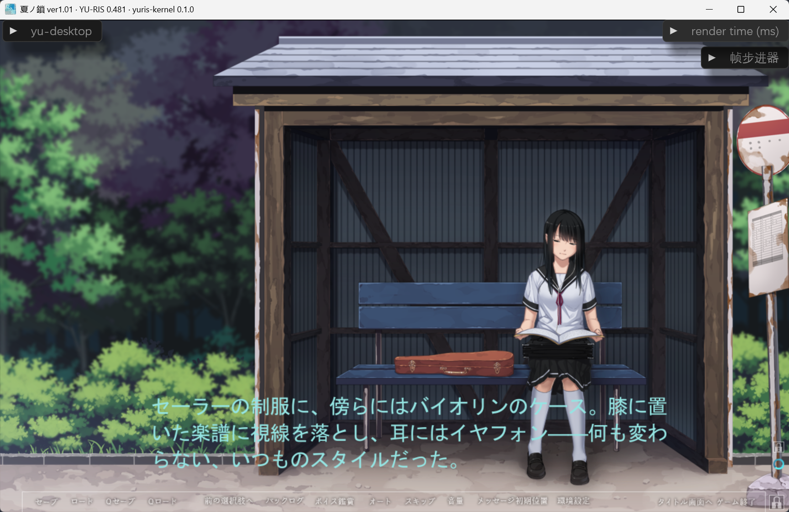
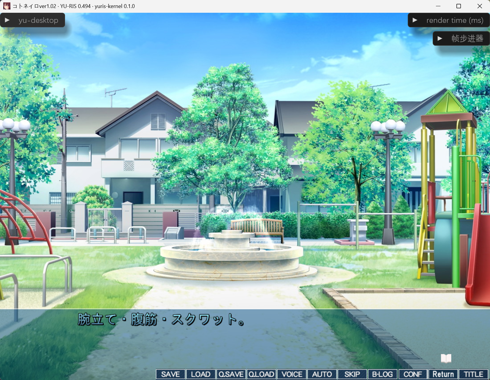
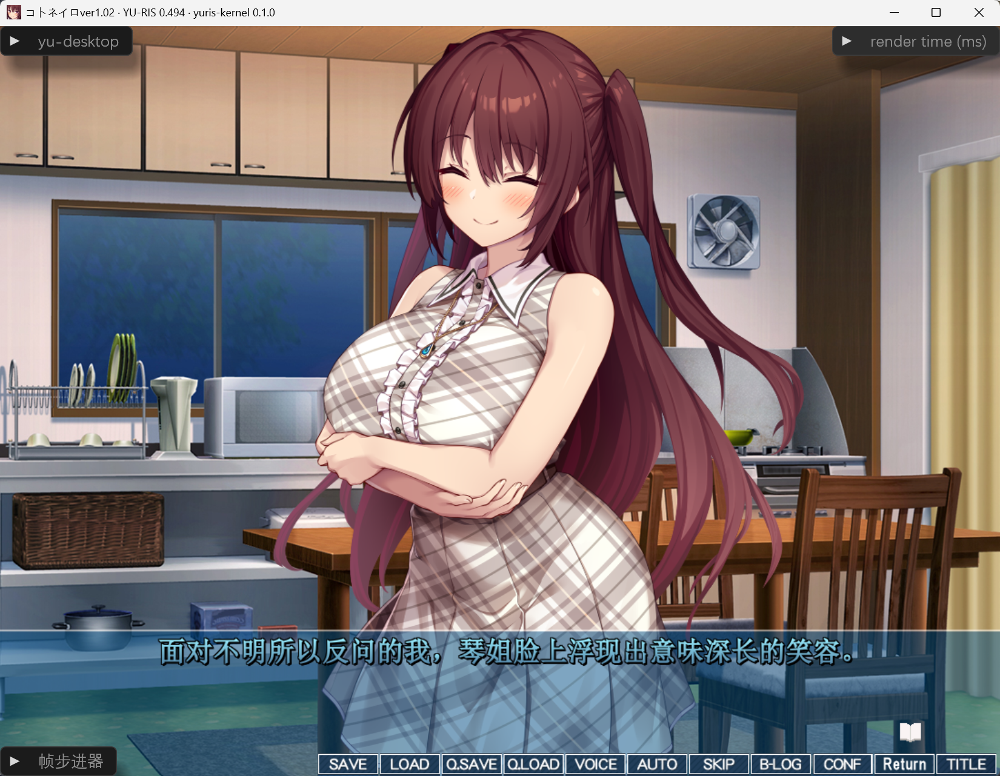
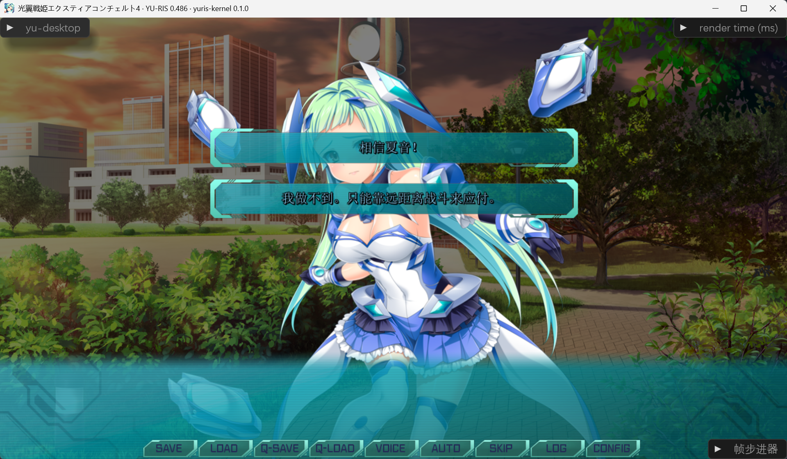
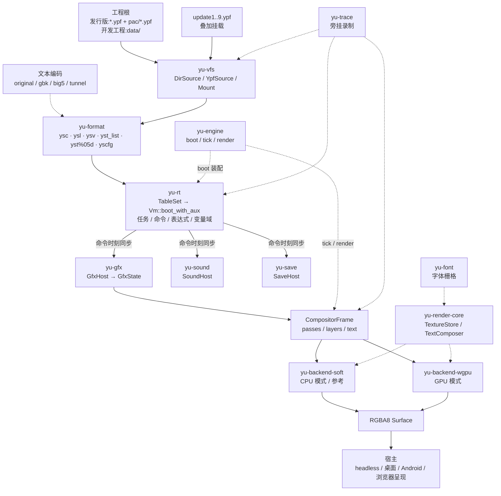

# yuris-kernel

YU-RIS 兼容运行时，开发中。

## 状态

当前主线是 4xx；2xx 适配中；5xx 观察中。

| 版本线 | 状态           | 说明                                                                                                                                    |
| ------ | -------------- | --------------------------------------------------------------------------------------------------------------------------------------- |
| 2xx    | 适配中         | 0.292 SDK：91 命令 / 482 系统变量；另有 0.255 表（539 变量）；YSTB V2 缺真实样本                                                        |
| 4xx    | 适配中（主线） | 0.466 / 0.479 / 0.495：100 / 104 / 119 命令，513 / 526 / 548 系统变量；0.494 商业包 ABI 548/548；实机验收 0.481 / 0.486 / 0.494 / 0.495 |
| 5xx    | 观察中         | v500 封包可读（YPF 版本字段无上限）；v555 仅有旁线局部观察，系统变量按 0.495 族前缀推断                                                 |

0.450–0.493 各版本的 ABI 表已全部入册（27 张，覆盖 0.255–0.495）

| 平台                | 状态   |
| ------------------- | ------ |
| Windows 桌面        | 可用   |
| headless / 本地服务 | 可用   |
| 浏览器呈现端        | 仅调试 |
| Android             | 可用   |

|  |  |  |
| ----------------------------- | ----------------------------- | ----------------------------- |
| 0.481                         | 0.481                         | 0.494                         |

## 文本编码

`--patch` 选汉化路线；桌面、serve、Android 配置界面用同一份取值。

| 汉化类型  | 取值                        | 说明                                                                          |
| --------- | --------------------------- | ----------------------------------------------------------------------------- |
| 原版日文  | `original`（`cp932`）       | 未汉化的原版                                                                  |
| 简体汉化  | `gbk`（`cp936` / `gb2312`） | 汉化补丁；译文放在散盘 `ysbin/`，靠「散盘先于封包」的读链生效                 |
| 繁体汉化  | `big5`（`cp950`）           | 同上，港台旧作与繁中补丁                                                      |
| SJIS 隧道 | `tunnel`（`sjis_ext`）      | 不动原编码、追加码点表的补丁；需游戏根有 `sjis_ext.bin`                       |
| 自动      | `auto`（缺省）              | 按 `codecs.json` → `sjis_ext.bin` → 工具签名识别；不认补丁名                  |
| 不支持    | —                           | exe / DLL 注入类补丁（如 `setdll` 挂 `MyDll.dll` 换字体）：不改程序，故不适用 |

<table>
<tr>
<td align="center"><br><sub><b>GBK 汉化</b></sub></td>
<td align="center"><br><sub><b>SJIS 隧道</b></sub></td>
</tr>
</table>

## Android

so + 轻量 Java 壳

- 构建：`tools/android/build.sh`，产物 `app-debug.apk` / `app-release.apk`（arm64-v8a + x86_64）。
- 安装后选游戏目录即可运行；存档写 `<游戏目录>/save/`，`.sd` 与桌面字节一致。
- 输入：触摸 = 鼠标左键，双指上下滑 = 滚轮，右下角切换虚拟鼠标。
- 退出：脚本 `END` 后回到配置界面。

## 构建

```bash
cargo build --release -p yu-cli
```

Windows 下生成 `yu-cli.exe`；桌面宿主已实现，其他平台的完整构建未验证。

```bash
# Android：so 交叉编译 + APK 打包
export ANDROID_HOME=/path/to/sdk ANDROID_NDK_HOME=/path/to/ndk JAVA_HOME=/path/to/jdk17
tools/android/build.sh                  # debug
BUILD_TYPE=release tools/android/build.sh
YURIS_SO_ONLY=1 tools/android/build.sh  # 只出 so
```

## 运行

数据入口按官方挂载规则：工程根下有 `data/` 目录即开发工程布局
（数据根 = `data/`），否则为发行版布局（数据根 = 工程根）。
数据根及其 `pac/` 下的全部 `*.ypf` 按文件名挂载，后挂覆写先挂；
`update1..9.ypf` 依次叠加为增量层；散盘内容目录叠在包之上。

```bash
# Windows 桌面窗口
target/release/yu-cli run "<project>" --mode desktop --backend wgpu --debug-ui

# 本地服务 + 浏览器呈现；默认打开浏览器，--no-open 只起服务
target/release/yu-cli serve "<project>" --backend wgpu --port 4173

# HMR
target/release/yu-cli dev "<project>" --backend wgpu --port 4173

# 用例
target/release/yu-cli case "<project>" --all

# 汉化
target/release/yu-cli run "<project>" --mode desktop --patch gbk
target/release/yu-cli run "<project>" --mode desktop --patch big5
target/release/yu-cli run "<project>" --mode desktop --patch tunnel

# 换钥作品:显式指定脚本密钥(8 位十六进制;缺省自动探测);存档写盘压缩
target/release/yu-cli run "<project>" --mode desktop --backend wgpu \
  --script-key 0x1A2B3C4D --save-codec snappy
```

## 测试

```bash
cargo test --workspace
```

仓库不附带游戏数据。缺样本时相关用例显式 `SKIP` 并计数；
`YURIS_REQUIRE_SAMPLES=1` 改为失败。

## 架构

`yu-engine` 负责 boot 装配与每帧 `Vm::tick_at` / render 调用。下图是数据流，
不是 crate 依赖图；`yu-trace` 是旁挂。



启动顺序：`Project` 发现数据入口 → `Vm::boot_with_aux` 装载表与入口 →
`GfxState::from_tables` → 把 `GfxHost` / `SoundHost` / `SaveHost` 装进 VM。
每帧 `Vm::tick_at` 执行任务，域宿主在命令时刻同步更新；`GfxState::frame()`
产出 `CompositorFrame`，后端合成 RGBA8。

## 目录

| 路径                                              | 内容                               |
| ------------------------------------------------- | ---------------------------------- |
| `crates/yu-log`                                   | 诊断与日志；所有 crate 的错误出口  |
| `crates/yu-vfs`                                   | 数据源、YPF、挂载                  |
| `crates/yu-format`                                | ybn、YSSD、YMV、CP932/GBK/Big5     |
| `crates/yu-rt`                                    | VM、任务、命令分派、变量域、ABI 表 |
| `crates/yu-gfx`                                   | 渲染语义与 `CompositorFrame`       |
| `crates/yu-sound` / `crates/yu-save`              | 声音 / 存档宿主                    |
| `crates/yu-font`                                  | 字体发现与字形栅格                 |
| `crates/yu-render/core`                           | 两后端共享契约                     |
| `crates/yu-render/soft` / `crates/yu-render/wgpu` | CPU 参考 / GPU 主后端              |
| `crates/yu-engine`                                | boot / tick / render 装配          |
| `crates/yu-cli`                                   | CLI、服务、HMR、用例               |
| `crates/yu-platform/*`                            | 桌面、Android、浏览器呈现、输入    |
| `crates/yu-trace`                                 | 录制 / 回放 / diff                 |
| `android/`                                        | Android 壳（Java）                 |
| `tools/android/build.sh`                          | so 交叉编译 + APK 打包             |

## 待办

- 渲染：多部件层几何语义、`CGINFO` 部分字段（`SX/SY` 未注入资产、`COLOR`）、
  缺失目标的非 EXIST 字段未收口；半像素 / quad 相位与过渡覆盖度待官方截图定论。
- 文本：官方「行完成清空 / `'P'` 清表面 / 宽度折行 / 每字符样式」与内核累积缓冲
  仍有差异；换行 / 行高 / 基线未与官方截图定论。
- 格式：YSTB V2 缺样本；YPF 旧 NUL-XOR 方言无样本，显式拒绝。
- 存档：SAVEINFO、图层导出未闭环；FILEACT[EXEC] 拒绝执行。
- 宿主：REGINFO 需注册表能力；CSVINFO / VAR 未取证；Linux / macOS 桌面与
  真 wasm（内存数据源 + 浏览器存档）未验证。
- 影片：只解 MPEG-1 program stream；MP2 音频未接入。
- E-mote：子模块 `yu-emote/`，主线暂缓。

## 文档

- `PROGRESS.md` — 进度、勘误、验证结果
- `docs/architecture.md` — 架构
- `docs/cross-platform.md` — 跨平台能力矩阵
- `docs/architecture/backends.md` — soft / wgpu 边界
- `docs/render-parity.md` — 渲染语义与证据
- `docs/todo-inventory.md` — 缺口清单
- `docs/references/open-source-tools.md` — 工具参考
- `docs/release.md` — tag 发布与产物
- `android/README.md` — Android 壳构建与实机验证

## 致谢

- [YU-RIS_Guide](https://github.com/TheVNConnoisseur/YU-RIS_Guide) —
  官方工具与 SDK 归档；本仓库的 27 张系统变量 ABI 表与 `YSCom.ycd` 语料取自该项目，
  每张表头记录来源 sha256 与覆盖版本区间（`crates/yu-rt/data/sysvar-abi-*.tsv`）。
- [Yuris-Tyn](https://github.com/Weiss-UltimateSavior/Yuris-Tyn) —
  启动链、任务 / 驱动形态、格式事实与 golden 回归参照；只读参考。
- [RxYuris](https://github.com/ZQF-ReVN/RxYuris) — YSTB / YSCM / YSTL 解析流程、
  YSCOM Loader。
- [YU-RIS-Script-Editor](https://github.com/Aionfatedio/YU-RIS-Script-Editor) —
  YSTB V5 段序、V2 版本带判定、编码自检测；未声明许可，仅事实参考，未复制代码。
- [YURIS_TOOLS](https://github.com/jyxjyx1234/YURIS_TOOLS) — 汉化文本流程与
  隧道码点分配算法。

## 相关仓库

- [yu-emote](https://github.com/NotFaceGUI/yu-emote) — E-mote（PSB/EMT）数据层与
  运行时；以子模块挂在 `yu-emote/`，暂缓开发。

## 许可

GPL-3.0-or-later。仓库不包含官方引擎代码、游戏数据或存档。
使用者需自行提供合法获取的游戏数据。
