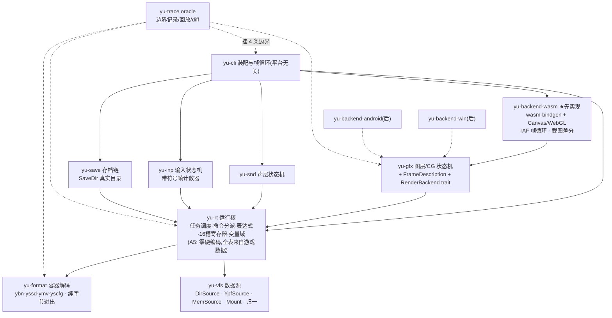

# yuris-kernel 架构

> 状态:设计基线 v1(2026-10-19)。上位文档:`README.md`(目标)、`docs/sdk-eris-analysis.md`(语义一手分析)、
> `docs/oracle.md`(对拍方法)、`CONTEXT.md`(术语)。

## 0. 不变式

| # | 不变式 | 含义 |
|---|---|---|
| A1 | **数据源不可见** | 散盘项目(SDK/ERIS 现状)与 .ypf 封包游戏,在 VFS 边界之上必须是同一个程序;两者差异只存在于 `yu-vfs` 一层 |
| A2 | 数据只读 | 游戏数据(散盘或封包)只读;唯一可写 = 真实存档目录(永不写进包) |
| A3 | 确定性 | 相同数据 + 相同输入时间线 ⇒ 相同事件流/帧序列/存档字节;时钟与 RNG 注入 |
| A4 | 真值=官方行为 | 一切语义对齐官方引擎可观测行为;旧线 golden 仅回归参考 |
| A5 | **通用运行时零硬编码** | 运行核与域状态机**禁止任何游戏/版本特定常量**:命令序号、命令名集合、参数关键字、资源路径、层 ID、坐标、分辨率、默认帧率、字体路径、编码……一律从游戏工程数据装载(ysc 命令表/ysv 变量表/yscfg 设置/yst_list 清单);**缺表 = 显式拒绝启动或 `Unimplemented`,禁止内置兜底表**。允许进代码的只有引擎算法语义(指令语义、混合公式、CRC/异或算法、调度规则)——那是"引擎是什么",不是"这个游戏是什么" |

## 1. 核心决策 A:数据源抽象(未封包 → 真封包的迁移轴)

```rust
pub trait DataSource {
    fn open(&self, path: &LookupKey) -> Result<Vec<u8>>;   // 或稀疏读句柄
    fn exists(&self, path: &LookupKey) -> bool;
    fn list(&self, dir: &LookupKey) -> Vec<Entry>;
}
```

三个实现,一个挂载栈:

```text
Mount(叠加栈, 后挂者覆盖先挂者):
  [ DirSource  散盘目录 ]      ← SDK/ERIS 项目: 现在
  [ YpfSource  .ypf 封包 ]     ← 商业游戏: base 包 + update1..9.ypf 依次覆盖 [REA 已证挂载顺序]
  [ MemSource  内存 ]          ← 测试夹具(合成微型 ypf/目录)
```

- **路径归一只做一次**:在 `yu-vfs` 内把请求折叠成查找键(分隔符 `/`=`\`、仅 ASCII A–Z 折叠、
  CP932 字节键),各数据源只做精确匹配。这是官方语义(Windows 文件系统行为),也是旁线被测试逼出来的契约。
- `ysbin\*.ybn`、`data/cg/...` 全部走同一 VFS——封包游戏里 ysbin 在包内(`yst%05d.ybn`),散盘项目里在目录里,上层无感。
- **等价性测试(架构自证,永久生效)**:同一棵文件树,分别以 DirSource 与"该树打包成的合成 YpfSource"
  挂载,`open/list/exists` 结果必须逐字节一致。这条测试在,散盘→封包的迁移就永远是零改动。
- 存档走独立的 `SaveDir`(真实目录),与 VFS 完全分离(A2)。

## 2. 核心决策 B:分层与 crate 划分

9 个 crate,依赖严格向下,边界=契约:



| crate | 职责 | 依赖 | 不许做 |
|---|---|---|---|
| `yu-log` | **错误+日志一体包**:Diag/错误码/LogSink/JSONL;所有 crate 的错误与日志唯一出口 | 无 | 成为旁挂(trace 从它消费,不是反向) |
| `yu-vfs` | DataSource 三实现 + Mount 叠加 + 路径归一;ypf 懒索引偏移直读 | log | 读真实文件系统之外的一切语义 |
| `yu-format` | ybn 家族容器与结构解码(YSCM/YSLB/YSVR/YSTD/YSTL、YSTB 脚本组/窗口)+ CP932/GBK 编解码器;bytes 进 structs 出 | log(纯) | 碰 IO;碰执行语义;**不碰 ypf(包布局归 yu-vfs)** |
| `yu-rt` | 命令组 VM:任务调度(让出=WAIT/显示文本)、按名分派、表达式求值(i64/f64/串)、16 槽 P/R 寄存器、变量域 | vfs, format, log | 渲染、音频、平台调用;**任何游戏/版本常量(A5)** |
| `yu-gfx` | 图层树/Z/混合的**语义状态机**;产出可序列化 **FrameDescription**;定义 **RenderBackend trait**(后端只负责把它画出来) | rt, log | 绕过 rt 直接读数据;含平台代码 |
| `yu-snd` / `yu-inp` | sound/input 子系统状态机(输入=带符号帧计数器) | rt, log | 同上 |
| `yu-save` | 存档链:变量域+任务+脚本位置快照,save/*.sd 字节级读写 | rt, log | 写任何非 SaveDir 路径 |
| `yu-backend-wasm` | **wasm 渲染后端(当前实现)**:Canvas/WebGL 呈现 FrameDescription + wasm-bindgen 宿主入口(rAF 帧循环、浏览器输入→InputTimeline、OPFS 存档) | gfx | 含游戏语义 |
| `yu-backend-win` / `yu-backend-android` | 同一 trait 的桌面/安卓实现(后续) | gfx | 同上 |
| `yu-trace` | 四条边界(①vfs 读 ②事件流 ③帧描述 ④平台命令)JSONL 记录/回放/diff;消费 yu-log 事件入流 | 全部(旁挂) | 成为运行时依赖 |
| `yu-cli` | 平台无关装配:输入时间线 → rt 泵 → 事件分流 → 域推进 → 交后端呈现 | 全部 | 含游戏语义;选后端是装配参数 |

## 3. 一帧数据流

```text
输入时间线(录制/回放/真实输入)
  → yu-inp 推进(@_KEY_* 符号计数器、@_MOUSE_*)
  → yu-rt: 泵所有任务至让出(WAIT/显示文本);任务全让出 = 帧边界
  → 事件流(VmEvent: cg/sound/text/save/scriptpos…)
  → 域状态机: gfx(图层树/Z)、snd(声层)、save(落盘意图)
  → 帧描述(可序列化) → 平台呈现(yu-cli)
  → yu-trace 在 ①②③④ 落 JSONL
```

## 4. 对齐要点(细节见 sdk-eris-analysis §7)

- 运行核只吃**已解码命令流**(.ybn),运行期零字符串解析;命令**按名**分派(ycd 表),跨版本不对序号。
- 宏不在运行核:宏是 **.yst→.ybn 编译器**(YSCom)的事。内核的自研编译器是独立工具(非运行时),
  用途仅一个:产"已知 .yst ↔ 官方 YSCom 编出的 .ybn"对拍语料; corpora 也可直接用商业游戏封包。
- 调用约定=PINT/PFLT/PSTR×16 + RINT/RFLT/RSTR×16 + PFLG/RFLG + 任务局部 T*;GOSUB 嵌套 64。
- 输入=带符号帧计数器;`TASK[SCRIPTPOS]`=剧本推进锚点,存档围绕它。

## 5. 渲染层与平台后端(wasm 先行)

**渲染后端 = 独立契约模块**,不是某个平台的附件:`yu-gfx` 产出可序列化的 `FrameDescription`
(图层清单:rid/变换/Z/混合模式/遮罩/文本串),`RenderBackend` trait 只有一份(定义在 `yu-gfx`),
平台实现各自一 crate:

```rust
pub trait RenderBackend {
    fn resize(&mut self, w: u32, h: u32);
    fn upload(&mut self, rid: ResourceId, rgba: &[u8], w: u32, h: u32);   // 纹理上传
    fn present(&mut self, frame: &FrameDescription);                      // 画一帧
    fn snapshot(&mut self) -> Rgba;                                       // 截图(对拍/差分用)
}
```

- **`yu-backend-wasm` 当前实现**(用户决策):`wasm32-unknown-unknown` + wasm-bindgen,
  Canvas/WebGL 呈现;宿主入口也在该 crate(rAF 帧循环、浏览器鼠标/键盘事件 → InputTimeline、
  存档落 OPFS)。wasm 先行的理由 = 调试回路最短:改完刷新即看、`snapshot()` 直接 toDataURL
  做逐帧像素差分、无安装成本。
- `yu-backend-win` / `yu-backend-android` 后续实现同一 trait;内核与 cli 装配层零改动,
  换后端只是换装配参数(A1 的平台版)。
- wasm 对架构的反向验证:浏览器无文件系统 ⇒ **一切读取只能走 DataSource**——散盘 DirSource
  在 wasm 上天然不可用,MemSource/OPFS 顶上,恰好证明 A1 抽象不是过度设计。
- 渲染语义的对齐责任划分:混合公式/Z 序/半像素偏移等**语义**在 `yu-gfx`(状态机决定每层怎么画),
  后端只做"把 FrameDescription 忠实搬到像素";像素级对拍用 `snapshot()` 差分。

## 6. 里程碑(每步退出条件可验证)

| 阶段 | 内容 | 退出条件 |
|---|---|---|
| M0 | yu-vfs:Mem/Dir/合成 Ypf + Mount + 归一 | **等价性测试**(§1)通过 |
| M1 | yu-format:ybn 家族解码 + 编解码器表(cp932/gbk) | 商业游戏真实 .ybn 语料解析成功且结构自洽 |
| M2 | yu-rt 泵核:任务/让出/分派/寄存器/变量域(零硬编码,全表装载) | 真实脚本事件流 golden 化;时钟注入可回放;**缺表拒绝启动**可测 |
| M3 | yu-gfx 最小闭环 + **yu-backend-wasm** | 浏览器里跑通 ERIS 首屏;snapshot 像素差分 golden |
| M4 | yu-save + 编解码器写回 | 官方 .sd 读→写回字节一致 |
| M5 | 真封包游戏端到端 | 同一内核二进制,换挂载栈即跑商业游戏;win/android 后端按需启动 |

## 7. 文本编码策略(统一编解码器)

**内部一律 Unicode(Rust `String`);"编码"只是字节边界上的编解码器参数。** 字节↔Unicode 转换
只允许发生在四处边界,内核深处不存在"当前编码"状态:

| 边界 | 方向 | 说明 |
|---|---|---|
| `yu-vfs` 查找键 | bytes→bytes | 资源名匹配是**字节级**操作,但多字节跳步表(前导字节范围)随编解码器不同:CP932 的 0xA1–0xDF 是半角片假名单字节,GBK 里却是前导字节——扫描必须选对跳步表 |
| `yu-format` 文本字段 | bytes↔String | ybn 指令流内字符串常量、yssd 存档文本、名字表,按编解码器解码成 Unicode 进入运行时 |
| `yu-save` 写回 | String→bytes | **存档必须按原编解码器写回**(A1 字节级兼容:GBK 汉化游戏的 .sd 写回还得是 GBK) |
| 文本呈现(gfx) | String→字形 | 字体只面对 Unicode;编解码器差异=字体覆盖需求(kana+汉字),不是渲染逻辑差异 |

- CLI 参数:`--codec cp932|gbk|auto`(缺省 auto;后续可扩 big5/utf8)。
- **编解码器是运行配置的一部分,进 trace 与 golden 头部**——同一次运行绝不二次探测、绝不中途切换(A3 确定性)。

### 自动识别(确定性,可复现)

auto 模式在启动早期、任何解码发生之前执行,顺序固定、平局裁决固定 ⇒ 同一输入永远同一结论:

1. 固定顺序采样三池字节:ybn 指令流内字符串常量 → 资源名字表 → 伴生 config 文本。
2. 双解码打分:分别按 CP932 与 GBK 解码,统计 (a) 非法序列数,(b) 字符构成——
   假名/半角假名密度 ⇒ CP932 权重;汉字且罕见日文假名 ⇒ GBK 权重。
   半角假名连(0xA1–0xDF 单字节 run)是 CP932 的强信号;GBK 2 字节覆盖率是 GBK 的强信号。
3. 裁决:得分差超阈值取高者;低于阈值**缺省 CP932**(日文为原生形态,汉化是少数)。
4. 结论 + 证据分数写入 trace/golden 头;`--codec` 显式指定时跳过探测并记录"用户指定"。

实现取向:自带 ~百行评分器(两个编解码器的合法序列表 + 构成统计),零依赖、可审计;
不引入通用探测库(其不确定性与本仓库 A3 冲突)。解码表用 `codepage` 映射静态表
(CP932/GBK 各一张,存 `yu-format`,与 yssd/ybn 的字节级往返共用)。

## 8. 错误系统与日志 = `yu-log`(排查即架构)

**错误与日志同包:`yu-log`**(类型 + 错误码 + 日志汇,零依赖,所有 crate 可依赖;trace 仍旁挂,
不进运行时依赖)。错误是结构化数据,不是字符串:

```rust
pub struct Diag {
    pub code: &'static str,      // 稳定命名空间码,如 "fmt.ybn.magic" / "rt.cmd.unknown" / "table.missing"
    pub severity: Severity,      // Fatal | Recoverable | Unimplemented | Info
    pub boundary: Boundary,      // Data | Format | Table | Script | Domain | Platform
    pub where_: Loc,             // 脚本:文件/标签/pc/命令名;数据:路径/偏移;表:表名
    pub detail: String,          // 人读详情(含期望 vs 实际)
    pub causes: Vec<Diag>,       // 因果链(底层错误逐层包裹)
}
```

- **七类边界码域**(与契约边界对齐并细分):`vfs.*` `fmt.*` `table.*`(A5 缺表→拒绝启动)
  `rt.*`(脚本执行:未知命令/缺槽/标签不存在/类型错)`gfx.* snd.* inp.*` `save.*` `platform.*`。
  码是数据:可计数、可进 golden、可直链 `docs/divergences/` 档案。
- **严重级语义对齐官方**:`Unimplemented`=已知语义未实装(挂号,留痕,按官方语义继续);
  `Recoverable`=官方引擎可继续(策略按官方观测填充——官方有 `ERROR[COM_XX=n]` 按命令族设
  错误等级 [yst 一手:es_First.yst],错误策略本身是脚本可见语义,必须建模);
  `Fatal`=引擎无法继续,产结构化报告(上下文链+最近 N 条日志)。
- **错误也是事件**:`yu-log` 的 JSONL 与 `yu-trace` 边界流同格式;trace 消费 log 事件入流
  (带帧号/域标),回放 golden 时错误序列一并比对——错误行为本身就是对齐对象。
- **日志**:统一走 `yu-log::LogSink`;CLI 端渲染人读行。**禁止散落 `println!`/`eprintln!`/`dbg!`**,
  CI grep 守卫(与 A5 守卫同族)。
- 排查路径:错误码 → divergences 档案/trace 上下文 → 边界二分。每个 Fatal 报告自带
  "哪条边界、哪个表、哪个脚本位置",不需要人再猜。

## 9. 明确不做(现阶段)

- .yst 自研编译器不进运行时(见 §4;作为独立工具仅在需要产"源码↔官方产物"对拍语料时启动)。
- E-mote/Flash 按目标游戏需要再定。
- 硬编码审计(A5 的执行手段):CI 级 grep 守卫禁止运行核/域状态机出现版本序号、内置命令表、
  内置资源路径常量;表装载事件全部进 trace,可审计"每一张表来自哪个游戏文件"。
